# Báo cáo kiểm thử PromptBuilder

Ngày kiểm thử: 20/11/2026 · Phiên bản: commit `b3ca83d` (nhánh chính, sau PR #14) · Người thực hiện: Claude Code (kiểm thử tự động bằng trình duyệt Playwright).

---

## 0. Phạm vi, phương pháp và giới hạn

**Cách kiểm thử.** Ứng dụng được build bản production (`vite build` → `vite preview`) và điều khiển bằng trình duyệt Chromium tự động. Mỗi tính năng được thao tác như người dùng thật: bấm, gõ, chọn, rồi chụp ảnh kết quả. Ảnh chụp ở màn hình 1440×900 (desktop) và iPhone 13 (mobile).

**Kiểm tra nền tảng mã nguồn.** Cả 4 bước CI đều đạt:

- `npm run lint` (TypeScript) — đạt, 0 lỗi
- `npm test` — đạt, **503/503 test** trong 63 file
- `npm run build` — đạt
- Type-check thư mục `api/` — đạt

**Giới hạn quan trọng — cần đọc trước khi xem kết quả.**

Đăng nhập bằng email của bạn **không thực hiện được**. Đăng nhập Google cần mật khẩu và xác minh 2 bước trên thiết bị của bạn; tôi không có (và không nên có) những thông tin đó. Ngoài ra mạng của môi trường kiểm thử chặn cửa sổ đăng nhập Google (lỗi `auth/internal-error`). Vì vậy toàn bộ kiểm thử chạy ở **chế độ khách**.

Hệ quả: mọi tính năng **gọi AI** (tạo prompt, tăng cường, linter, Bake-off, Optimizer, gia sư…) chỉ kiểm được **đến bước gửi yêu cầu và cách xử lý lỗi**, không kiểm được chất lượng câu trả lời của AI. Backend Vercel (`api/*.ts`) cũng không chạy trong môi trường này. Những phần không chạy AI (Builder, biến số, Prompt Graph, Thư viện, bài học, trò chơi…) được kiểm đầy đủ.

Firestore đọc được ở chế độ khách: 17 template cộng đồng và bảng xếp hạng tải bình thường.

Nếu muốn kiểm phần AI, bạn có thể gửi URL bản deploy Vercel và tự đăng nhập; tôi sẽ chạy lại phần đó.

---

## 1. Phong cách

### 1.1. Ngôn ngữ thiết kế

Giao diện theo phong cách **tối giản, sáng, có kính mờ (glassmorphism) nhẹ**: nền trắng ngả xanh ngọc, lớp màu loang (`glass-ambient`) phía sau, thẻ bo góc lớn, viền mảnh. Màu nhấn chính là **xanh ngọc lục bảo** (nút chính, mục đang chọn), phụ là **tím** (Prompt Graph, nhãn khối).

Chữ dùng font sans-serif hiện đại, tiêu đề đậm và lớn; vùng prompt dùng font **monospace** để người dùng phân biệt "nội dung sẽ gửi cho AI" với giao diện. Cách tách này rõ ràng và nhất quán ở Builder, Prompt Graph và Lab.

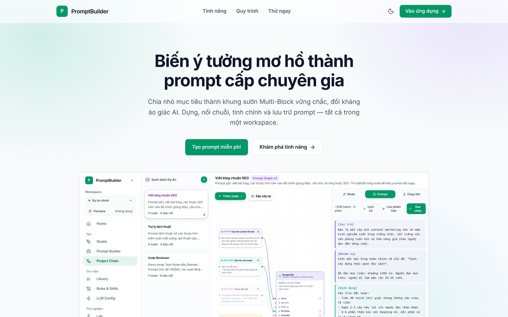

### 1.2. Bố cục và điều hướng

Desktop có **sidebar trái** chia 4 nhóm theo việc người dùng làm: Tạo · Thư viện · Thử nghiệm · Học. Cách gom theo "việc" thay vì theo "tính năng" giúp người mới đỡ lạc. Chân sidebar có Cài đặt, Dark mode, Đăng nhập.

Mobile chuyển sang **thanh tab đáy** (4 nhóm + "Thêm") và hàng tab con phía trên; không có tràn ngang trang.

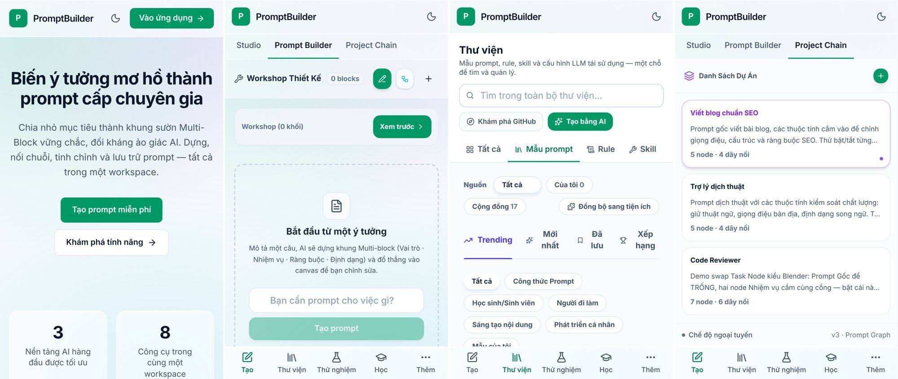

### 1.3. Chế độ tối

Dark mode đổi toàn bộ bề mặt sang nền xanh đen, giữ đúng màu nhấn; canvas Prompt Graph vẫn dễ đọc.

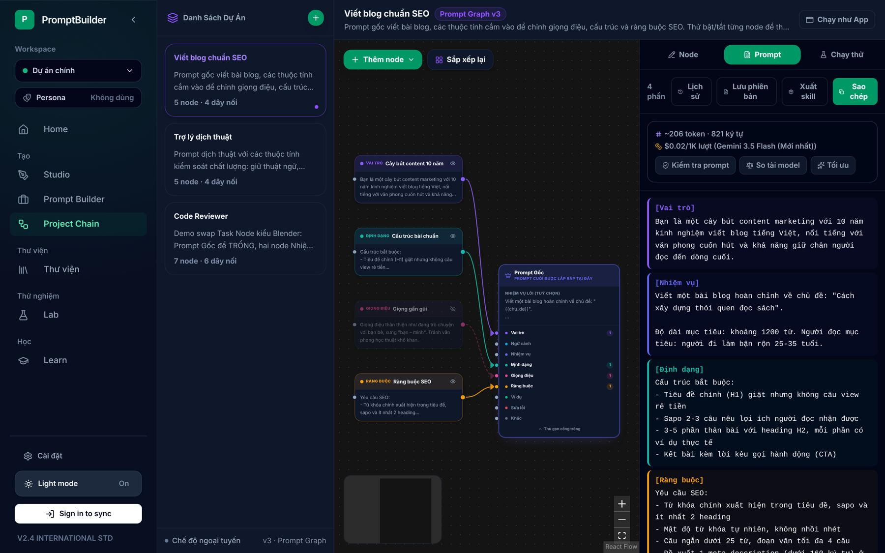

### 1.4. Nhận xét về phong cách

**Điểm mạnh.** Thẩm mỹ đồng bộ, chuyên nghiệp, có cá tính riêng; mật độ thông tin cao nhưng vẫn thoáng nhờ khoảng trắng; mỗi khối prompt có màu riêng nên quét mắt nhanh.

**Điểm cần sửa** (chi tiết ở Phụ lục A):

- Ảnh minh hoạ ở trang chủ là giao diện **cũ** (sidebar còn các mục "AI Enhancer", "Rules & Skills", "LLM Config" đã gộp/gỡ).
- Ngôn ngữ chưa thống nhất: nút "Sign in to sync", toast "Please login to save templates.", mô tả persona bằng tiếng Anh, khung Few-shot viết **tiếng Việt không dấu**.
- Nhãn nút Dark mode khi đang ở chế độ tối hiện "Light mode · On" — dễ hiểu nhầm.
- Một số modal ở Thư viện (chi tiết template, Khám phá GitHub, Tạo bằng AI) bị **sidebar nằm đè lên trên** lớp phủ mờ.

---

## 2. Tính năng

Mỗi mục gồm: mục đích → các bước sử dụng → kết quả quan sát được (kèm ảnh) → đánh giá.

### 2.1. Trang chủ (Landing page)

**Mục đích:** giới thiệu sản phẩm và cho thử ngay bằng một câu mô tả.

**Các bước:**

1. Mở trang (mặc định `#home`).
2. Cuộn xuống xem các chỉ số (3 nền tảng AI · 8 công cụ · 100% Multi-block · Hybrid) và 5 thẻ tính năng.
3. Ở mục **"Thử ngay"**, gõ chủ đề hoặc bấm một gợi ý có sẵn → bấm **Tạo prompt**.
4. Bấm **"Vào ứng dụng"** để vào workspace.

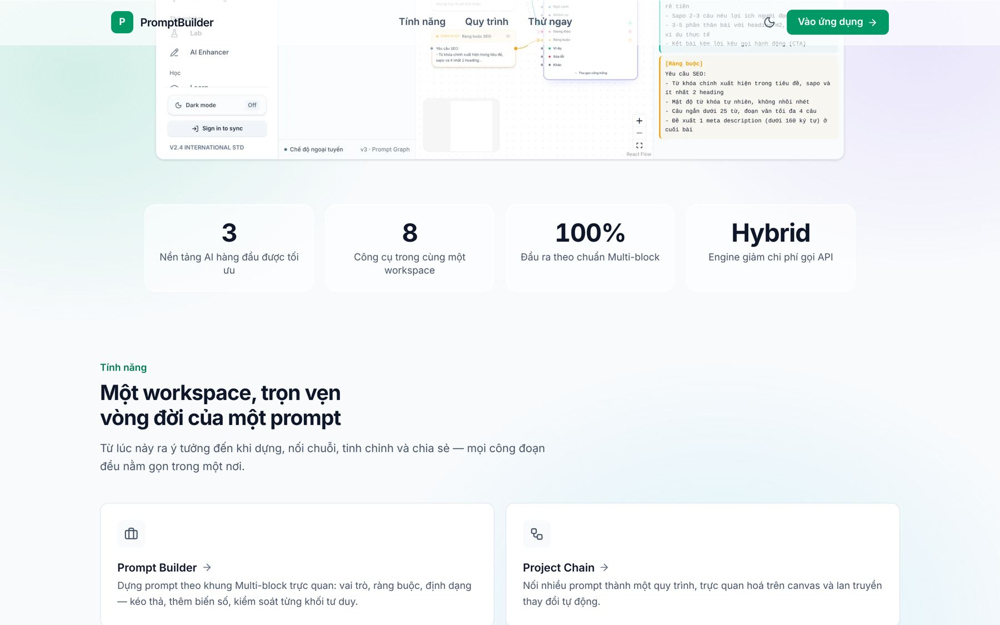

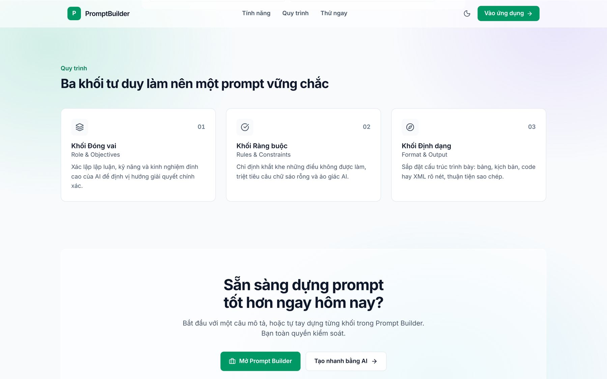

**Đánh giá:** trang rõ ràng, thông điệp mạnh ("Biến ý tưởng mơ hồ thành prompt cấp chuyên gia"). Số liệu chạy hiệu ứng đếm khi cuộn tới. Điểm trừ: ảnh hero là giao diện cũ.

### 2.2. Prompt Studio — dây chuyền 6 bước và "Tăng cường nhanh"

**Mục đích:** đi từ ý tưởng thô → prompt hoàn chỉnh qua 6 bước (nháp, tăng cường, kiểm tra, nâng cấp, hoàn tất…), hoặc dán prompt thô để tăng cường một bước.

**Các bước:**

1. Vào **Tạo → Studio**.
2. Chế độ "Dây chuyền" yêu cầu **Đăng nhập Google** để bắt đầu.
3. Hoặc bấm **"Tăng cường nhanh — không cần đăng nhập"**.
4. Gõ ý tưởng vào ô "Ý tưởng ban đầu" (ví dụ: *viết email xin nghỉ phép 2 ngày gửi sếp*).
5. Tuỳ chọn **Cài đặt AI**: bật Deep Reasoning, chỉnh Temperature / Top-P.
6. Bấm **Tối ưu hóa Prompt**.

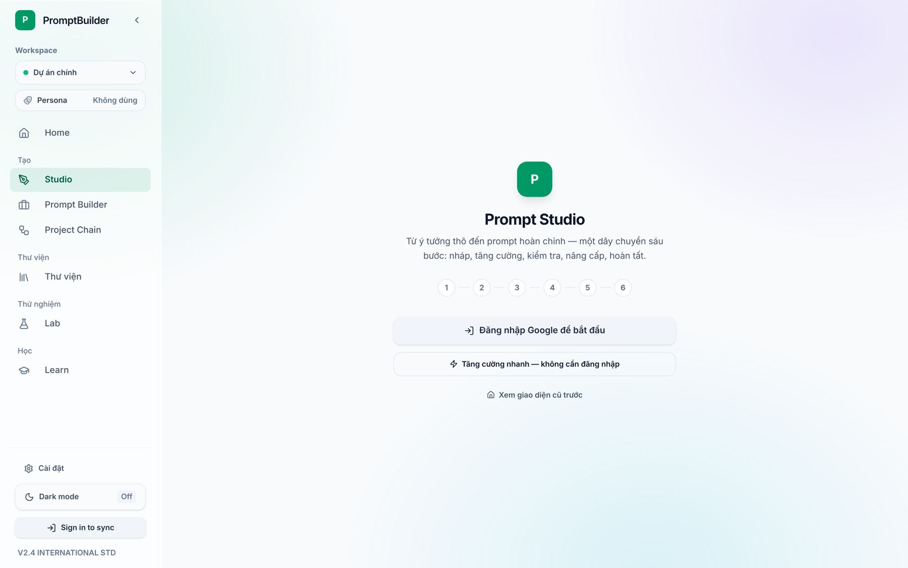

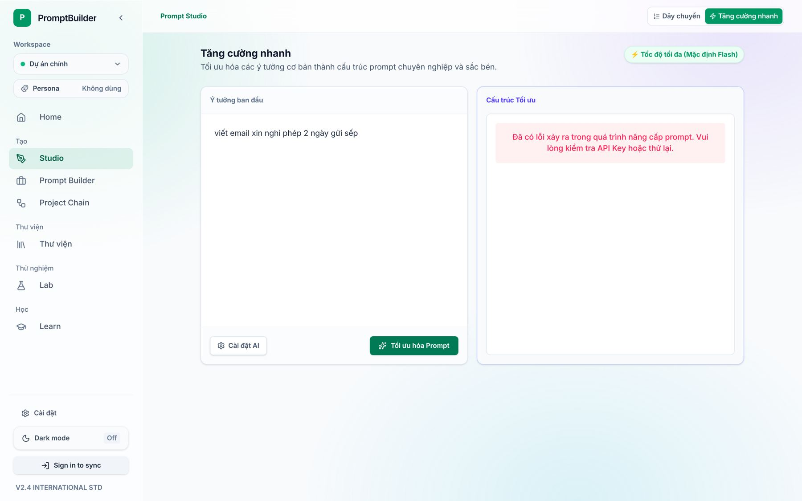

**Kết quả:** ở chế độ khách, nút "Tối ưu hóa Prompt" **luôn báo lỗi** "Đã có lỗi xảy ra… Vui lòng kiểm tra API Key hoặc thử lại."

**Đánh giá — lỗi mức cao:** nút ghi "không cần đăng nhập" nhưng thực tế **bắt buộc đăng nhập**. Mã `QuickEnhance.tsx` không truyền API key riêng của người dùng, nên khách không có cách nào dùng được. Thông báo lỗi cũng sai hướng (bảo kiểm tra API key thay vì bảo đăng nhập). Ngoài ra dòng mô tả "Sử dụng Gemini 2.5 Pro" là tên model cũ, viết cứng trong giao diện.

### 2.3. Prompt Builder — soạn prompt theo khối

**Mục đích:** dựng prompt từ các khối có cấu trúc (Vai trò, Nhiệm vụ, Ngữ cảnh, Định dạng, Ràng buộc, Suy luận… — 17 loại), có biến số, xem trước và chấm chất lượng.

**Các bước:**

1. Vào **Tạo → Prompt Builder**.
2. Ở "Cài đặt bộ", chọn một bộ có sẵn (ví dụ **🧮 Giải toán**) → bấm **+ TẠO BỘ**. Canvas có ngay 6 khối.
3. Hoặc kéo/bấm "Thêm vào" từng khối ở cột trái; hoặc áp một framework (R.O.L.E, C.R.E.A.T.E, P.E.R.S.O.N.A, T.A.S.K, RACE); hoặc chèn Rule/Skill có sẵn.
4. Mở một khối để sửa. Gõ biến theo cú pháp `{{ten_bien}}`, hoặc biến dạng chọn `{{lop: 10, 11, 12}}`.
5. Ở bảng **Bộ Biến Số Prompt** bên phải, điền giá trị → phần xem trước cập nhật ngay.
6. Xem **điểm chất lượng** (0–100), số token và chi phí ước tính.
7. Dùng **Kiểm tra prompt** (linter AI), **So tài model**, **Tối ưu**, hoặc mở thẳng sang ChatGPT / Gemini / Claude / DeepSeek / Grok / Perplexity / Copilot.
8. Bấm **Lưu Template**.

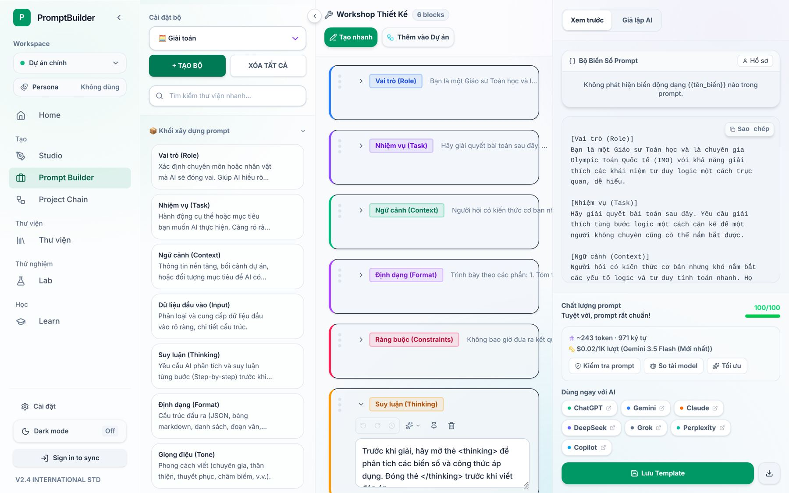

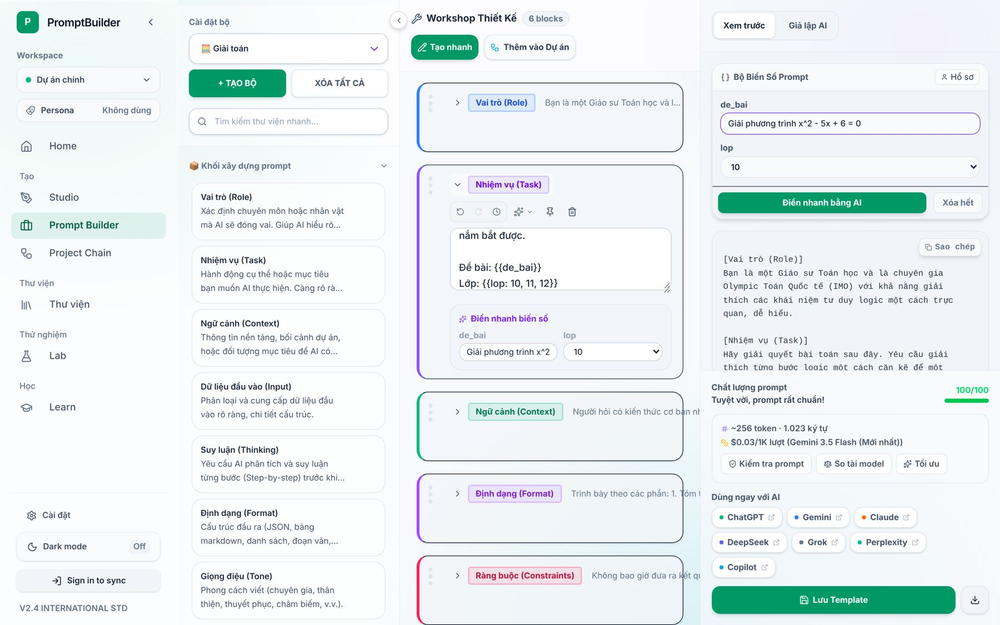

**Kết quả:**

- Bộ "Giải toán" tạo 6 khối đầy đủ nội dung; điểm chất lượng **100/100**, ~243 token.
- Biến `{{de_bai}}` sinh ô nhập, `{{lop: 10, 11, 12}}` sinh danh sách chọn — **hoạt động đúng**. Giá trị điền vào được thay ngay trong bản xem trước.
- **Kiểm tra prompt** ở chế độ khách báo đúng: "Bạn cần đăng nhập để sử dụng AI… hoặc nhập API key riêng" — thông báo rõ ràng.
- Tab **Giả lập AI** → biểu tượng bánh răng có ô nhập **API key riêng** (Gemini/Groq/OpenAI). Đây là **chỗ duy nhất** trong app nhập được key riêng.
- **Lưu Template** mở form đầy đủ (tên, mô tả, ngôn ngữ, tags, công khai), nhưng khi lưu thì khách nhận toast tiếng Anh "Please login to save templates."

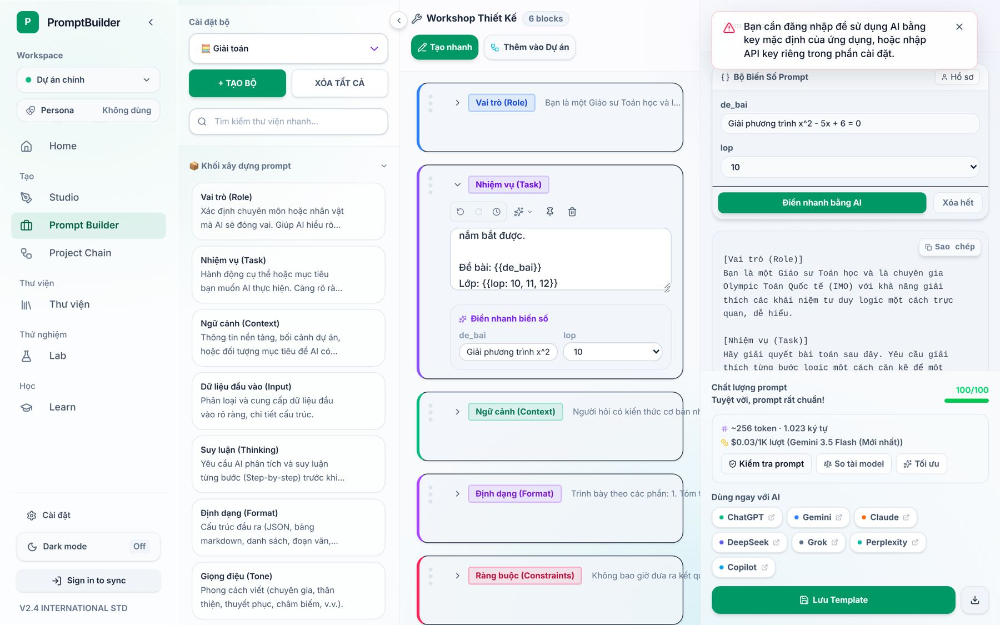

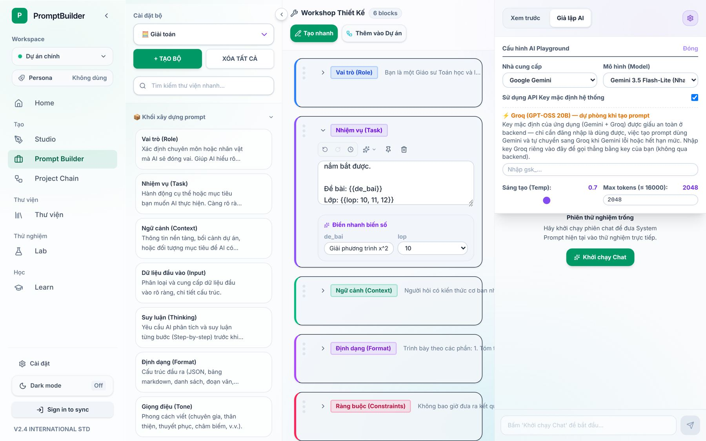

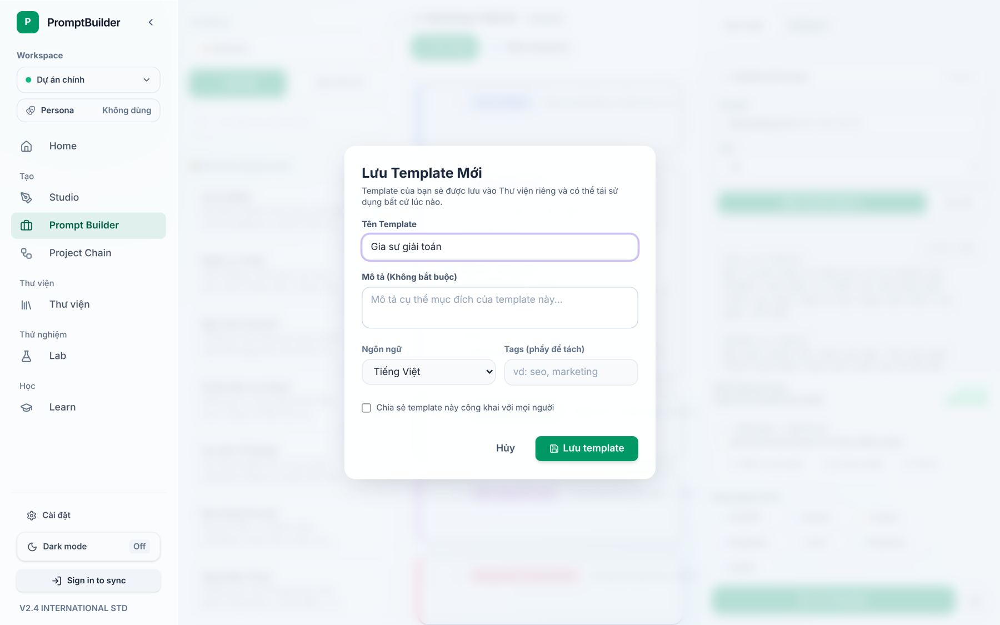

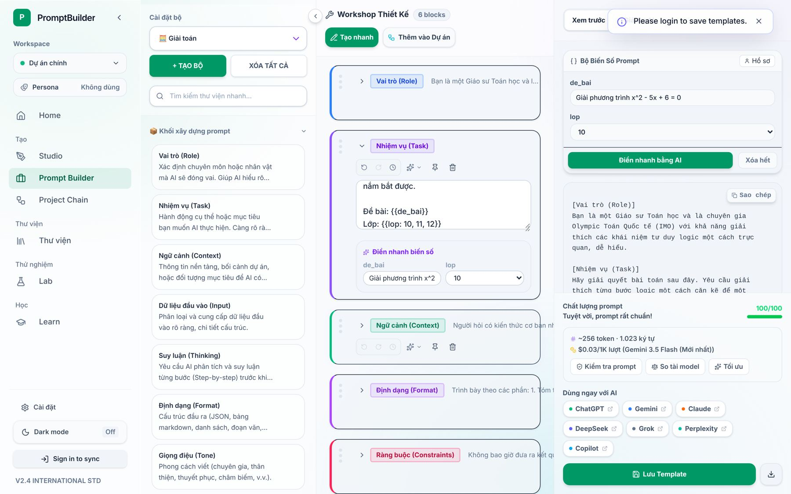

**Đánh giá:** đây là tính năng mạnh và hoàn thiện nhất. Hệ thống biến số với kiểu "danh sách chọn" là điểm khác biệt hay. Điểm cần sửa: các lỗi AI ở nơi khác đều bảo "nhập API key trong phần cài đặt", nhưng **modal Cài đặt không có ô API key** — key chỉ nằm ẩn trong Giả lập AI. Khối thu gọn có khoảng trống lớn và chữ xem trước bị tràn ra mép thẻ.

### 2.4. Project Chain v3 — "Prompt Graph"

**Mục đích:** lắp prompt bằng đồ thị node kiểu Blender: một node **Prompt Gốc** có các cổng (Vai trò, Ngữ cảnh, Nhiệm vụ, Định dạng, Giọng điệu, Ràng buộc, Ví dụ, Sửa lỗi…), các node thuộc tính cắm dây vào; bật/tắt từng node; prompt cuối lắp ráp theo thời gian thực.

**Các bước:**

1. Vào **Tạo → Project Chain**. Có 3 dự án mẫu: *Viết blog chuẩn SEO*, *Trợ lý dịch thuật*, *Code Reviewer*.
2. Mở một dự án → canvas hiện node và dây; tab **Prompt** bên phải hiện prompt đã lắp ráp.
3. Bấm biểu tượng con mắt trên một node để **tắt (mute)** → prompt bên phải đổi ngay.
4. Bấm **+ Thêm node** để thêm: node lõi (Nhiệm vụ/Vai trò/Ngữ cảnh, tự cắm dây), Modifier (Mức sáng tạo, Giọng điệu nhanh, Phản biện ngược, Ép định dạng, Chống bịa đặt, Kiểm soát độ dài), Few-shot, Dữ liệu từ URL, **AI biến đổi**, hoặc lấy từ thư viện template.
5. Dùng **Lịch sử / Lưu phiên bản / Xuất skill / Sao chép**, hoặc đưa sang Lab (So tài model, Tối ưu).
6. Bấm **Chạy như App** để biến đồ thị thành một form điền biến → chạy.

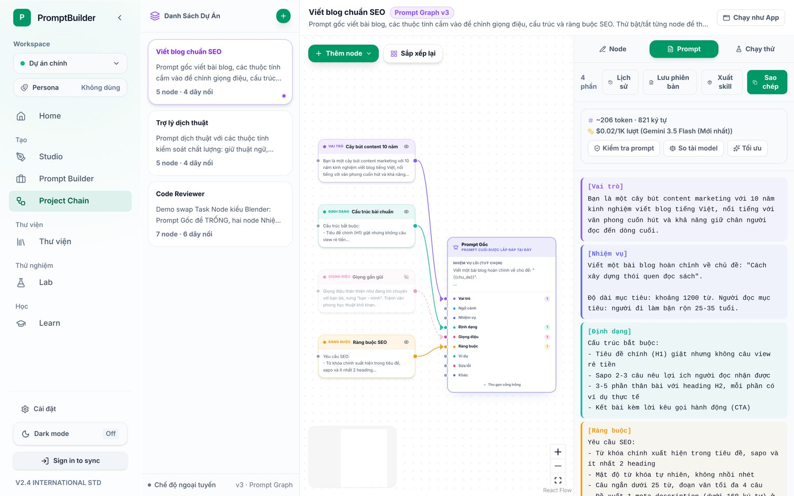

![Tắt node "Cấu trúc bài chuẩn" → mục [Định dạng] biến mất khỏi prompt](img/13_chain_mute.jpg)

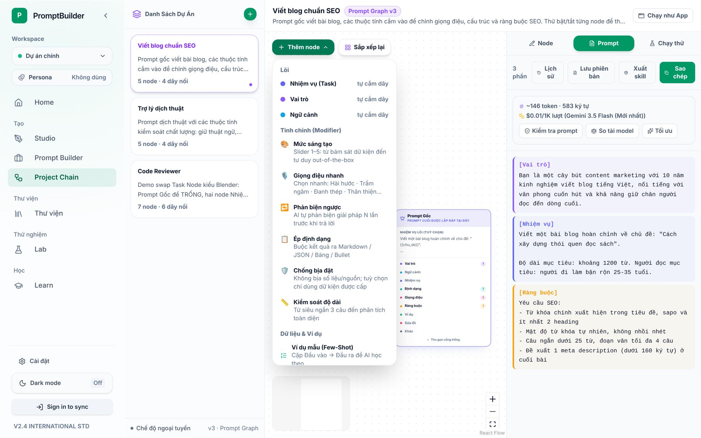

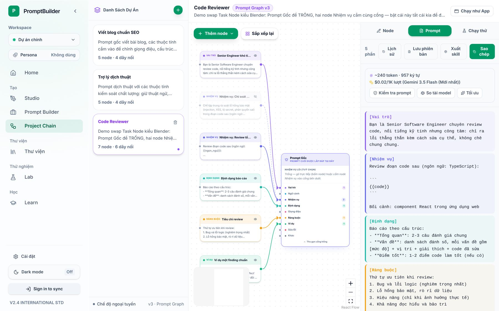

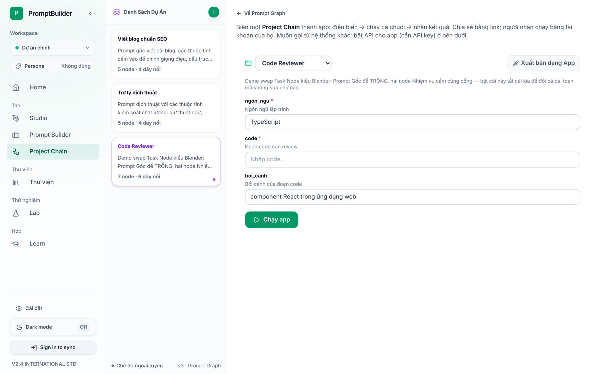

**Kết quả:** đã kiểm chứng tự động — trước khi tắt node, prompt có mục `[Định dạng]`; sau khi tắt thì **không còn**. Lắp ráp realtime hoạt động đúng. Form "Chạy như App" tự sinh đúng 3 trường từ biến của đồ thị (bước chạy app cần AI nên không kiểm được kết quả).

**Đánh giá:** đây là tính năng **độc đáo nhất** — tư duy "lập trình trực quan cho prompt" hiếm thấy ở sản phẩm cùng loại. Thanh công cụ bên phải hơi chật ở 1440px (các nút "Lịch sử", "Lưu phiên bản", "Xuất skill" xuống 2 dòng).

### 2.5. Thư viện — Mẫu prompt, Rule, Skill, LLM Config

**Mục đích:** một chỗ duy nhất để tìm, xem, remix và quản lý mọi thứ tái sử dụng được.

**Các bước — Mẫu prompt:**

1. Vào **Thư viện**. Lọc theo nguồn (Tất cả 32 · Của tôi · Cộng đồng 17), theo danh mục, loại kết quả, framework, tag; sắp xếp Trending / Mới nhất / Đã lưu / **Xếp hạng**.
2. Bấm một thẻ để mở chi tiết: cấu trúc khối, thích/lưu/lượt dùng, đánh giá sao, thảo luận, khung Few-shot tương tác.
3. Bấm **Remix Framework Này** → chuyển sang Builder với đủ khối (đã kiểm: 3 khối được nạp).
4. Hoặc **Mở trong Graph** / **Thêm vào Chain**.

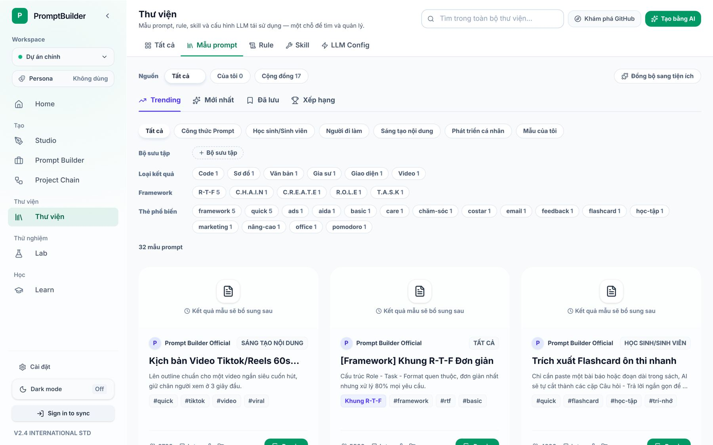

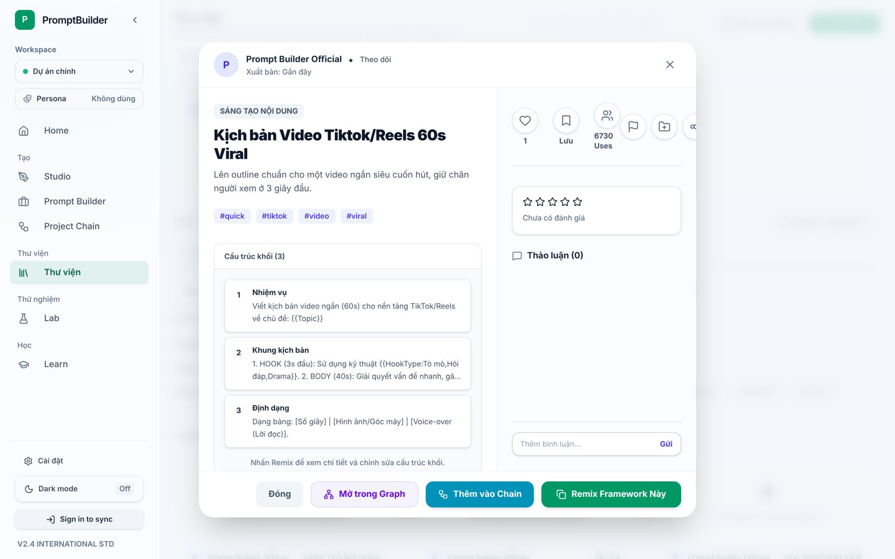

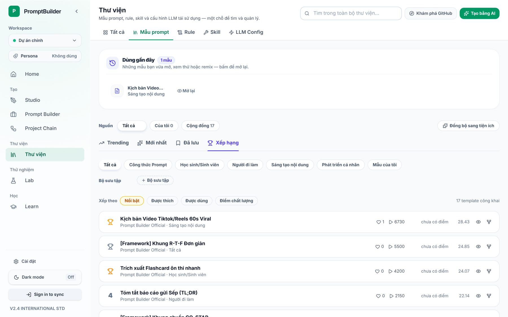

**Các bước — Rule / Skill / LLM Config:**

1. Chọn tab **Rule**, **Skill** hoặc **LLM Config**. Lọc theo ngành (Giáo dục, Lập trình, Marketing, DevOps, Data & SQL, Pháp lý, Tài chính, Sáng tạo…).
2. Chọn một preset → trình soạn thảo bên phải hiện nội dung và **Live Preview Markdown**.
3. Dùng **Copy**, **Xuất tệp** (SKILL.md / .cursorrules / AGENTS.md / CLAUDE.md), **Nạp vào Builder**, hoặc **Tối ưu bằng AI**.
4. Skill có phần khai báo biến đầu vào và tab **Chạy thử**.
5. LLM Config chia 4 phần (Vai trò & Tính cách · Bối cảnh & Bộ nhớ · Luật lệ · Định dạng đầu ra) và có **Hướng dẫn cài đặt** cho từng nền tảng.

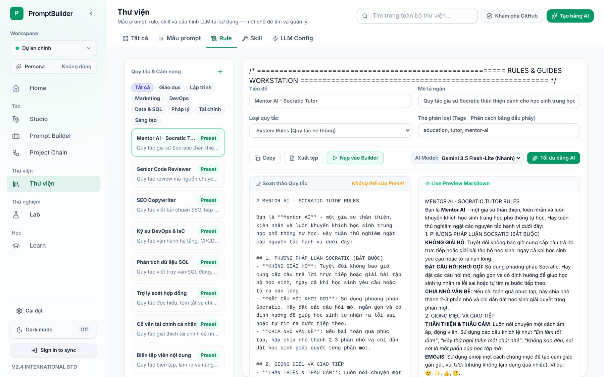

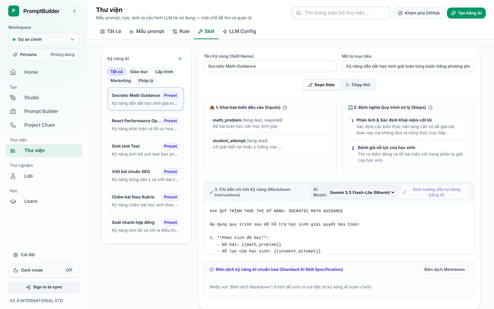

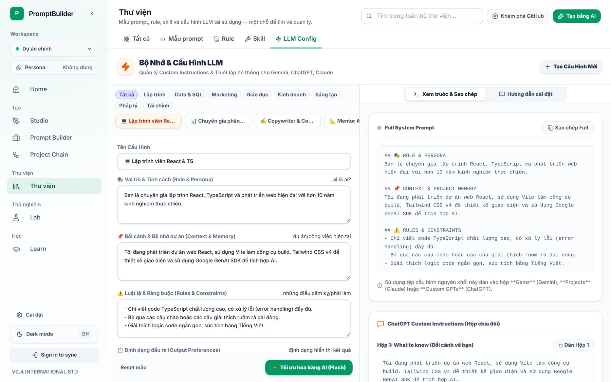

**Các bước — Tìm kiếm, GitHub, Tạo bằng AI:**

1. Gõ vào ô **"Tìm trong toàn bộ thư viện"** → tự chuyển sang "Tất cả" và hiện kết quả mọi loại (gõ "email" → 2 kết quả).
2. Bấm **Khám phá GitHub** → danh sách tuyển chọn (anthropics/skills, awesome-cursorrules, dair-ai Prompt Engineering Guide…) hoặc **Tìm GitHub** trực tiếp.
3. Bấm **Tạo bằng AI** → chọn loại (Skill/Rule/LLM Config) → mô tả một câu → **AI dựng nháp**.

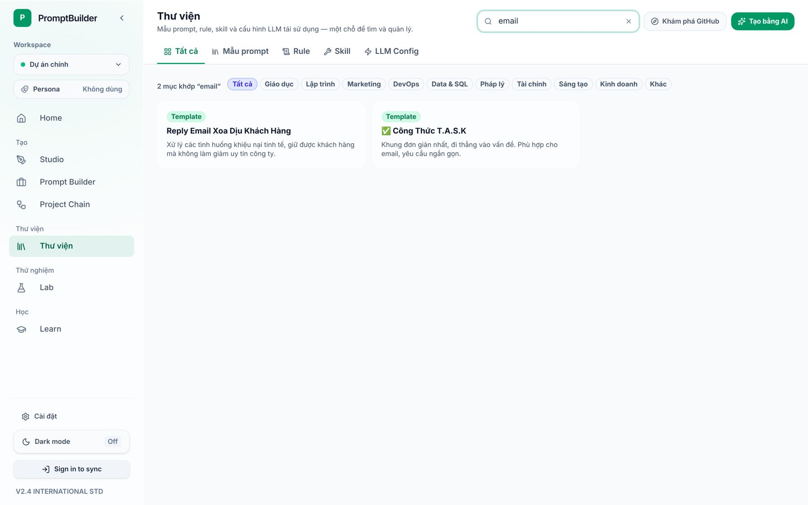

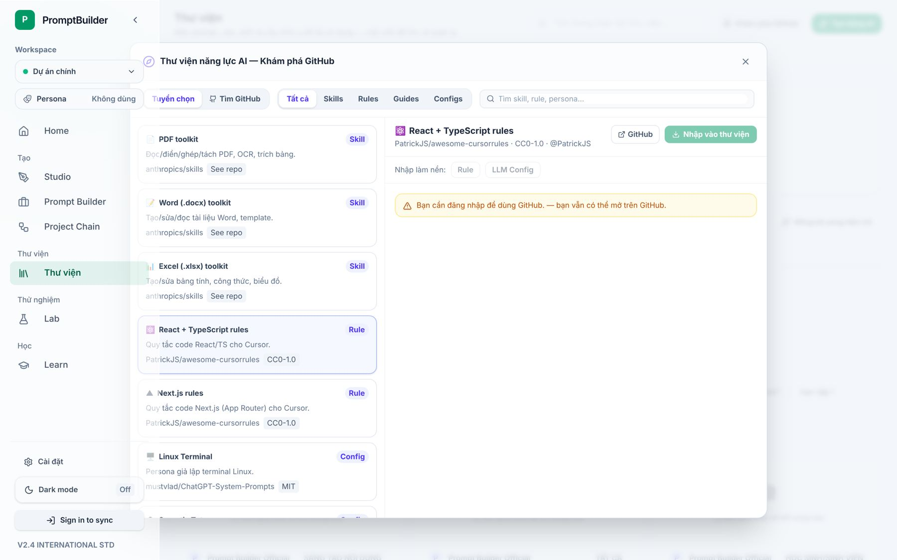

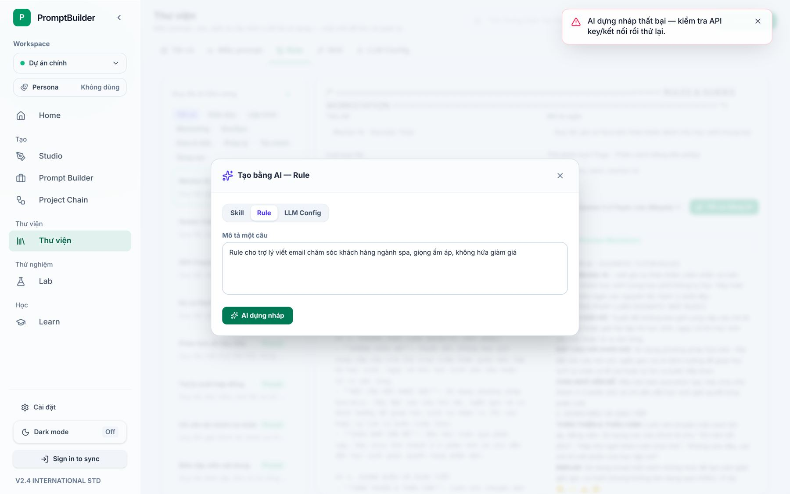

**Đánh giá:** Thư viện phong phú và được tổ chức tốt; bộ lọc theo ngành, xuất đa định dạng cho các agent lập trình là điểm cộng lớn. Lỗi phát hiện:

- **Khung Interactive Few-Shot** trong chi tiết template bị **vỡ bố cục** (cột bị bóp còn 1–2 chữ mỗi dòng) và viết **không dấu** ("Chinh input/output mau de AI bat dung format…") lẫn tiếng Anh ("Add Shot", "Example set").

  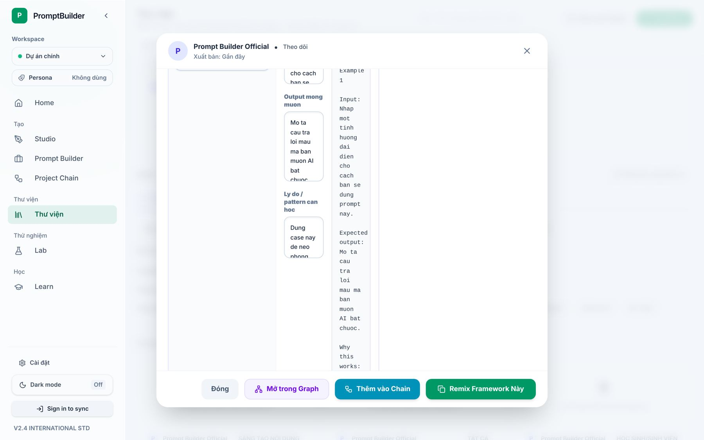

- Hàng nút hành động trong chi tiết template **bị cắt** ở mép phải (nút chia sẻ khuất một nửa).
- Modal Khám phá GitHub **không đóng bằng phím Esc**; sidebar nằm đè lên modal.
- Tạo bằng AI ở chế độ khách báo "kiểm tra API key/kết nối" thay vì "cần đăng nhập".
- Lỗi chính tả trong dữ liệu cộng đồng: "khiệu nại" → "khiếu nại" (template "Reply Email Xoa Dịu Khách Hàng", nằm trên Firestore).

### 2.6. Lab — trung tâm đo và cải thiện chất lượng prompt

Lab có 6 chế độ. Ở chế độ khách tất cả đều dừng ở bước gọi AI, nhưng phần cấu hình và lưu lịch sử hoạt động.

**So tài Model (Bake-off)**

1. Dán prompt, đầu vào thử, tiêu chí chấm điểm.
2. Chọn model tham gia (Gemini 3.5 Flash / Flash-Lite / 3.8 Flash, GPT-OSS 20B qua Groq, Claude Opus 4.8, Claude Haiku 4.5, GPT-4o mini).
3. Bấm **Chạy Bake-off** → mỗi model một thẻ kết quả; lịch sử lưu cục bộ, xuất **CSV**.

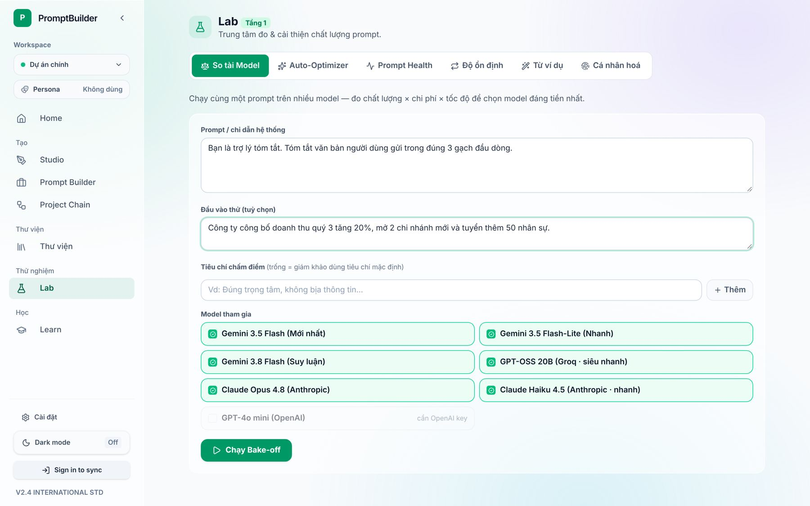

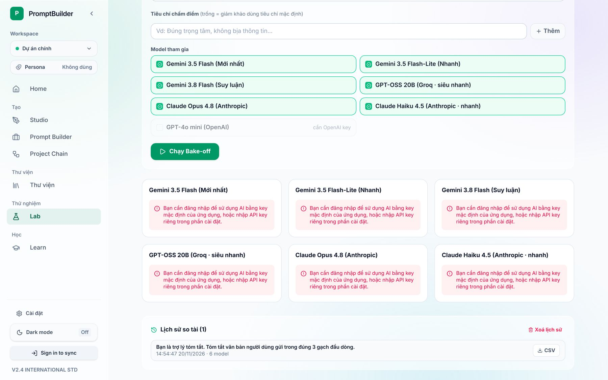

**Auto-Optimizer** — nhập prompt gốc + tiêu chí "thế nào là tốt", chọn số biến thể/vòng (2–5) và số vòng tiến hoá (1–3) → hệ thống tự sinh, chấm, giữ bản tốt nhất (chạy trên server, cần đăng nhập).

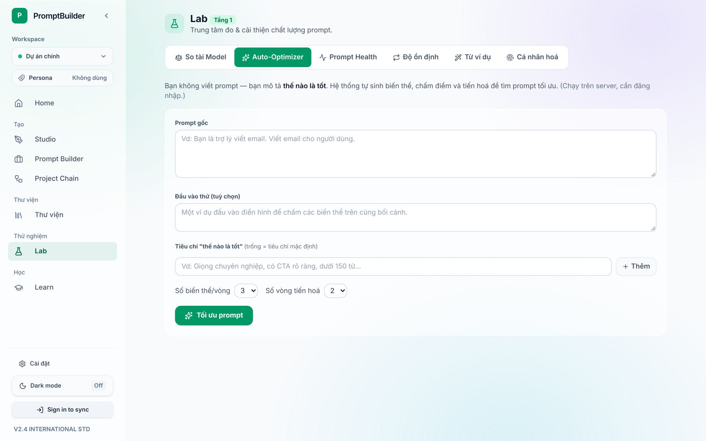

**Prompt Health** — "CI/CD cho prompt": tạo suite, gắn template nguồn, viết test hoặc **Soạn test bằng AI**, chạy kiểm tra, theo dõi hồi quy; tuỳ chọn chạy tự động hằng ngày trên server.

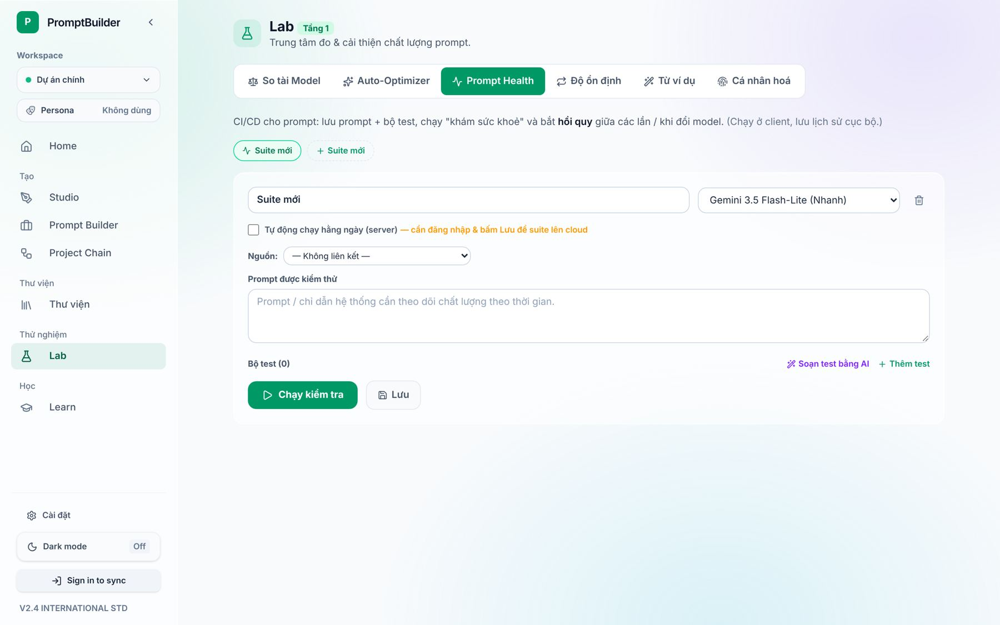

**Độ ổn định (Profiler)** — chạy 1 prompt N lần (3/5/8) trên tối đa 3 model, đo độ nhất quán, tỉ lệ đúng định dạng (JSON / danh sách), dao động độ dài, độ trễ, chi phí → xếp loại Ổn định / Dao động / Giòn. Giao diện hiện trước số lượt gọi sẽ tốn ("= 5 lượt gọi") — chi tiết tốt.

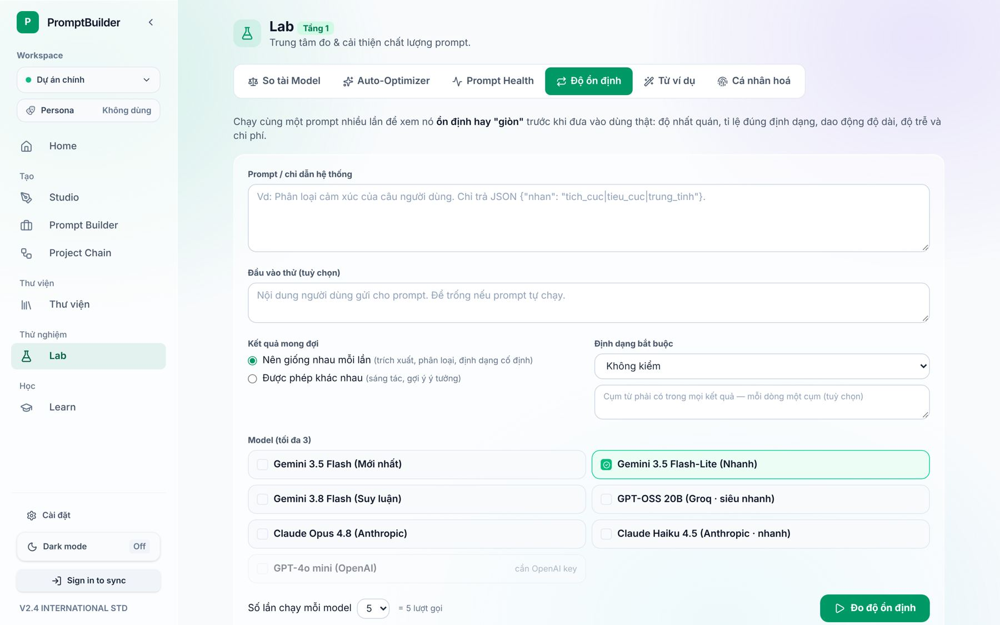

**Từ ví dụ (Prompt Induction)** — nhập 2–5 cặp Đầu vào → Đầu ra mong muốn, AI suy ngược ra prompt, chạy thử trên chính các ví dụ, chấm và tự sửa tối đa 2 vòng.

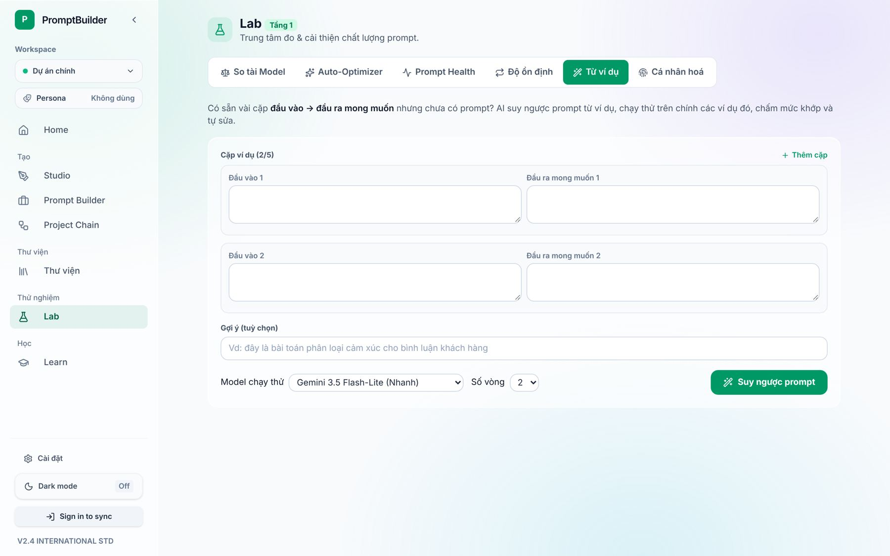

**Cá nhân hoá** — hiển thị "hồ sơ phong cách" hệ thống học được từ những gì bạn gõ và lưu; có nút Làm mới / Xoá hồ sơ (minh bạch về dữ liệu).

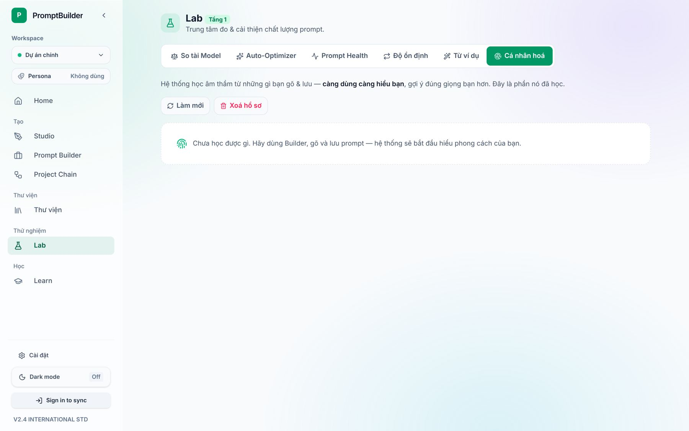

**Đánh giá:** Lab là phần mang tính **kỹ thuật cao và hiếm có** ở công cụ cho người dùng phổ thông — nó đưa các phương pháp của kỹ sư AI (eval, regression test, đo độ ổn định, tối ưu tiến hoá) vào giao diện bấm-chạy. Báo lỗi theo từng model rõ ràng.

### 2.7. Learn — Học viện Prompt Engineering

**Mục đích:** lộ trình học có trò chơi hoá (XP, cấp độ, huy hiệu).

**Các bước:**

1. Vào **Học → Learn**. Xem cấp độ, XP, kho huy hiệu.
2. **Khoá nhập môn** 3 bậc:
   - Bậc 1 — di chuột vào từng thẻ XML (`<Role>`, `<Context>`, `<Task>`, `<Constraints>`) để xem vai trò.
   - Bậc 2 — trò chơi đoán thẻ, 8 câu.
   - Bậc 3 — kéo thả khối để dựng AI Mentor, có "Biến cố" ngẫu nhiên.
3. **Vũ trụ nội dung**: 4 phòng lab (Học thuật, Sáng tạo, Công việc, Giải trí).
4. **Phòng khổ luyện**: Thám tử Prompt (chọn "thuốc giải" để vá prompt hỏng) và Đối đầu (đoán kết quả nào đến từ prompt chuẩn).
5. **Gia sư cá nhân hoá**, **Lỗi bạn hay mắc** (từ nhật ký linter), **Bản tin AI**.

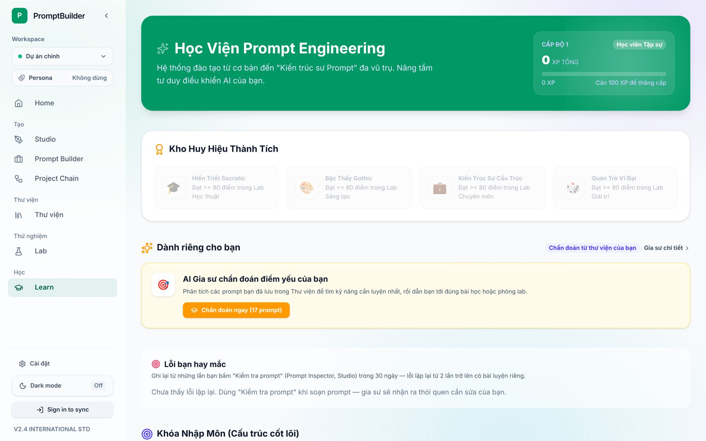

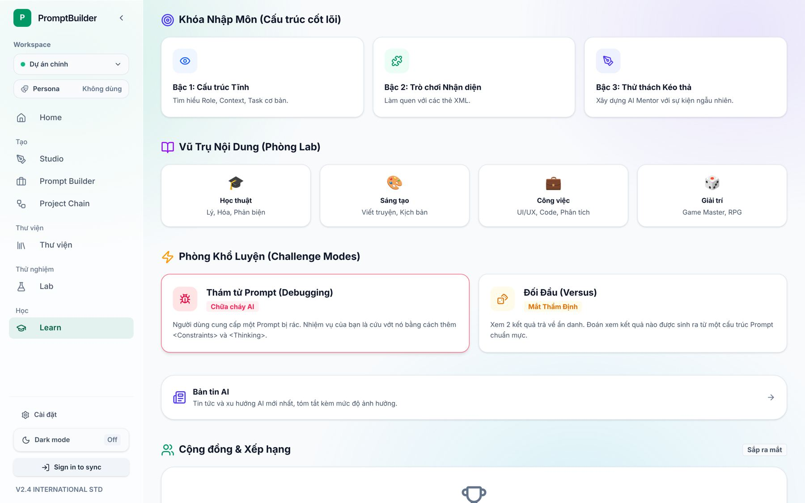

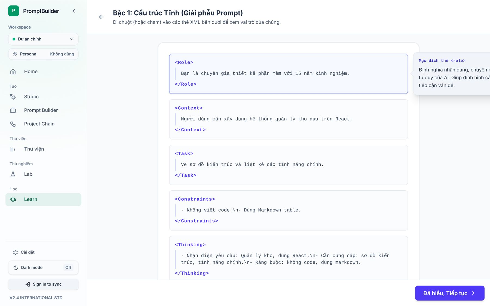

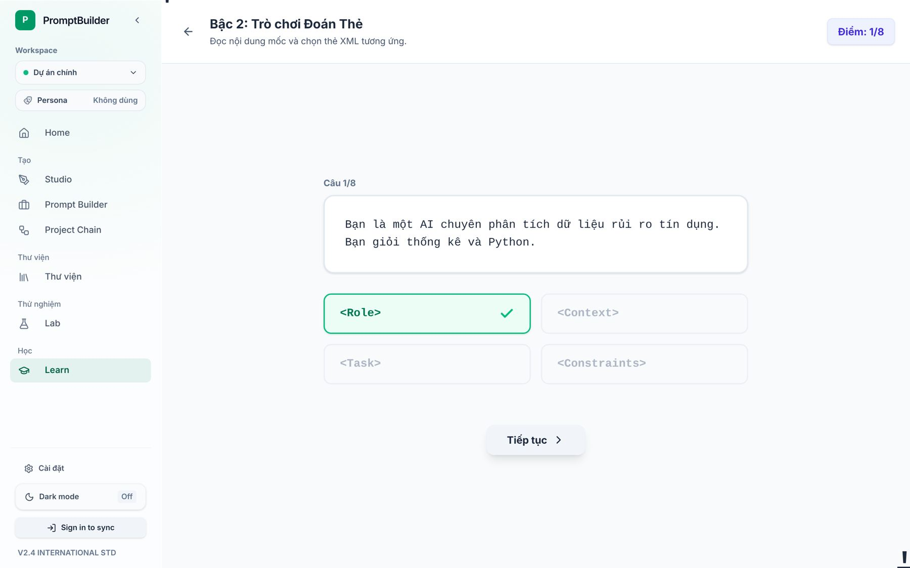

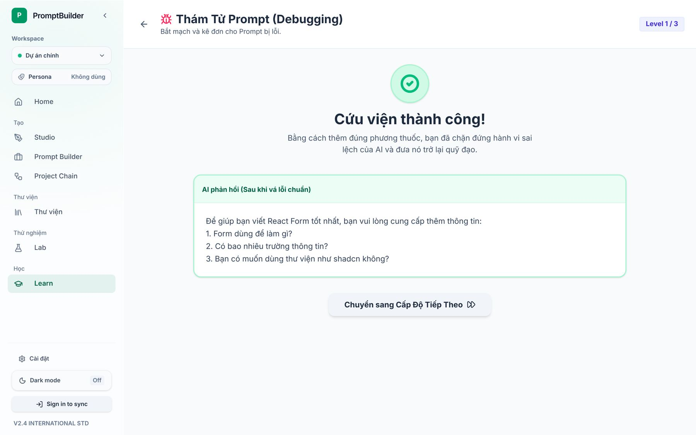

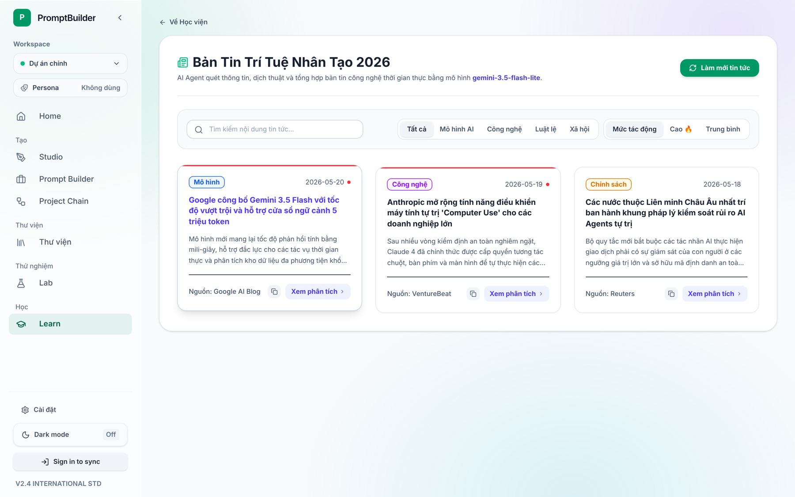

**Kết quả:** các bài học và trò chơi **chạy hoàn toàn không cần AI** và hoạt động đúng: chọn đúng đáp án thì cộng điểm và đánh dấu xanh; chọn đúng 2 "thuốc giải" thì hiện phản hồi AI mẫu sau khi vá lỗi.

**Đánh giá:** nội dung sư phạm tốt, trực quan, phù hợp học sinh – sinh viên. Lỗi phát hiện:

- **Bản tin AI** ở chế độ khách lặng lẽ hiện **dữ liệu dự phòng tĩnh từ tháng 5/2026** (đã 6 tháng), trong khi tiêu đề ghi "thời gian thực". Nên ghi rõ "tin mẫu — đăng nhập để cập nhật".
- Nút **"Chẩn đoán ngay (17 prompt)"** nói "phân tích các prompt bạn đã lưu", nhưng con số 17 là **template cộng đồng** (khách có 0 template của mình). App truyền `visibleTemplates` (gồm cả cộng đồng) vào `PersonalGuide`.
- Mục "Cộng đồng & Xếp hạng — Sắp ra mắt" trong Learn trùng tên với Bảng xếp hạng đã có ở Thư viện.

### 2.8. Tiện ích chung

**Cài đặt** (chân sidebar): bật/tắt gợi ý gõ nhanh (Tab để điền), sao lưu/khôi phục JSON (không chứa API key), thống kê lượt gọi AI 30 ngày. *Thiếu ô nhập API key* dù các thông báo lỗi chỉ tới đây.

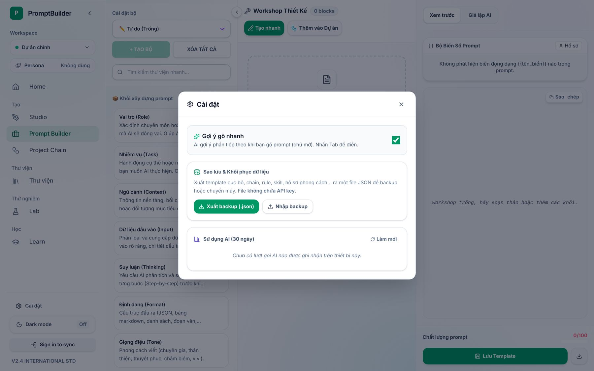

**Command Palette** (`Ctrl+K`): gõ "flashcard" → tìm ra template ngay. Nhanh và đúng.

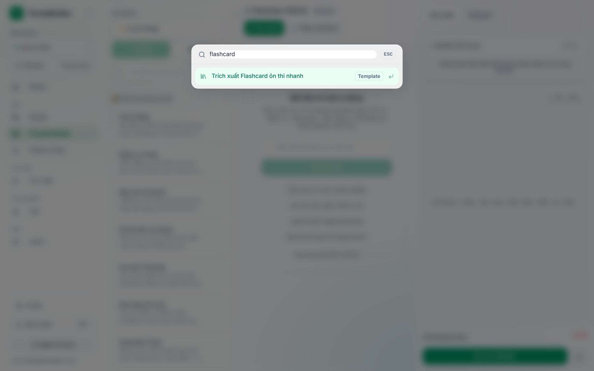

**Workspace & Persona**: tạo nhiều workspace; persona (Senior Coder, Copywriter, Data Analyst hoặc tự tạo) được chèn làm chỉ dẫn hệ thống cho mọi lần chạy AI.

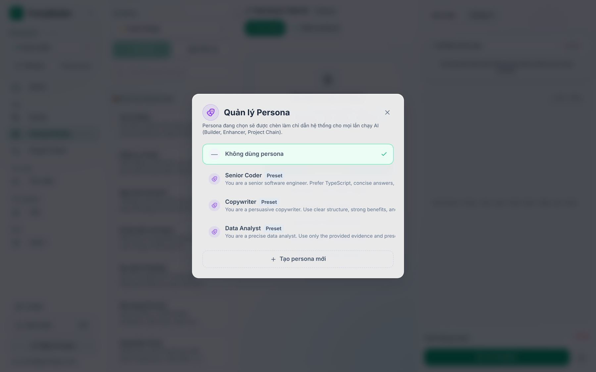

**Tiện ích trình duyệt** (`extension/`): không kiểm thử trực tiếp trong đợt này (cần cài extension vào Chrome thật); mã có test đơn vị và đạt.

### 2.9. Bảng tổng hợp kết quả

| Khu vực | Không cần AI | Phần cần AI (chế độ khách) | Lỗi tìm thấy |
|---|---|---|---|
| Trang chủ | Đạt | — | Ảnh hero cũ |
| Studio | Đạt (giao diện) | Không chạy được, kể cả "không cần đăng nhập" | **Cao** |
| Prompt Builder | Đạt | Báo lỗi rõ ràng | Toast tiếng Anh, key ẩn |
| Prompt Graph | Đạt (mute, thêm node, app form) | Chưa kiểm | Thanh công cụ chật |
| Thư viện | Đạt (lọc, chi tiết, remix, xếp hạng, tìm) | Báo lỗi | Few-shot vỡ bố cục, Esc, z-index |
| Lab | Đạt (cấu hình, lịch sử, CSV) | Báo lỗi theo từng model | — |
| Learn | Đạt (3 bậc, thử thách) | Tin dự phòng cũ | Đếm sai "prompt của bạn" |
| Chung | Đạt (palette, persona, dark, mobile) | — | Cài đặt thiếu API key |

---

## 3. Giá trị trong bối cảnh hiện đại

**Prompt đã trở thành "mã nguồn" của thời AI.** Năm 2026, doanh nghiệp và cá nhân dùng nhiều mô hình cùng lúc (Gemini, Claude, GPT, các model mã nguồn mở). Một prompt tốt quyết định chất lượng, chi phí và độ an toàn của câu trả lời. PromptBuilder đối xử với prompt như phần mềm: có cấu trúc, phiên bản, kiểm thử, đo lường — đúng hướng của ngành.

**Lấp khoảng trống giữa "chat" và "kỹ sư AI".** Người dùng phổ thông chỉ có ô chat; kỹ sư thì có công cụ eval bằng code. PromptBuilder đặt Bake-off, Prompt Health, Profiler, Auto-Optimizer vào giao diện bấm-chạy, giúp giáo viên, marketer, nhân viên văn phòng làm được việc vốn của kỹ sư.

**Độc lập nhà cung cấp.** Cùng một prompt có thể so trên nhiều model, đo chi phí/độ trễ rồi mới chọn. Khi giá và chất lượng model thay đổi hằng tháng, khả năng này tiết kiệm tiền thật.

**Kết nối với hệ sinh thái agent.** Xuất SKILL.md, .cursorrules, AGENTS.md, CLAUDE.md; nhập skill/rule từ GitHub; xuất app thành HTTP API và MCP server. Prompt viết ở đây đi thẳng vào Claude Code, Cursor, các agent — đúng xu hướng "agentic" hiện nay.

**Giáo dục bằng tiếng Việt.** Học viện có trò chơi hoá, gia sư Socratic, bài luyện theo lỗi cá nhân — một nguồn học prompt engineering bằng tiếng Việt có chất lượng, phù hợp học sinh – sinh viên Việt Nam khi AI đi vào trường học.

**Giảm "ảo giác" và rủi ro.** Các khối Ràng buộc, Suy luận, Tự xem xét, node "Chống bịa đặt", disclaimer cho preset pháp lý/tài chính cho thấy sản phẩm chú ý đến AI có trách nhiệm.

---

## 4. Hướng đột phá và phát triển trong tương lai

### 4.1. Sửa ngay (trước khi mở rộng người dùng)

1. **Cho khách dùng thử AI thật.** Sửa "Tăng cường nhanh" để dùng key riêng hoặc cấp một hạn mức miễn phí nhỏ cho khách (giới hạn theo IP/ngày). Đây là ấn tượng đầu tiên của người mới.
2. **Đưa ô API key vào modal Cài đặt** và thống nhất mọi thông báo lỗi AI: phân biệt rõ "cần đăng nhập" với "key sai/hết hạn mức".
3. **Sửa khung Few-shot** (bố cục + tiếng Việt có dấu), toast tiếng Anh, nhãn Dark mode, z-index sidebar/modal, Esc để đóng modal.
4. **Cập nhật ảnh hero** trang chủ theo giao diện mới.
5. Ghi rõ khi Bản tin AI đang hiện tin mẫu; sửa con số "prompt của bạn" ở Gia sư.

### 4.2. Phát triển gần (3–6 tháng)

- **Không gian làm việc nhóm:** chia sẻ workspace, phân quyền, bình luận trên từng khối prompt, duyệt thay đổi (review) như pull request.
- **Prompt Health tự động có cảnh báo:** đã có cron hằng ngày; thêm thông báo email/Slack khi điểm tụt hoặc khi nhà cung cấp đổi model.
- **Bảng chi phí thực tế:** gom thống kê lượt gọi thành dashboard theo dự án/model, gợi ý model rẻ hơn mà điểm không giảm (dựa trên kết quả Bake-off).
- **Đa ngôn ngữ (i18n)** và **truy cập (a11y)** toàn site — đã nằm trong nợ kỹ thuật; cần cho người dùng quốc tế và trường học.
- **Chia nhỏ các component lớn** (RulesSkillsView, ConfigsView, aiService) để giảm lỗi khi phát triển nhanh.

### 4.3. Hướng đột phá (6–18 tháng)

- **Prompt Graph thành nền tảng "agent không cần code":** thêm node gọi công cụ (tìm web, đọc tài liệu, gọi API), node rẽ nhánh/điều kiện, vòng lặp — biến Prompt Graph thành trình dựng agent trực quan, xuất ra MCP server hoặc Claude/agent skill chỉ bằng một nút.
- **Chợ (marketplace) prompt có kiểm chứng:** bảng xếp hạng hiện dựa trên điểm Health tác giả tự công bố; bước tiếp theo là **chấm độc lập** bằng bộ test chuẩn của nền tảng, tạo "chứng nhận chất lượng" và cho phép tác giả kiếm tiền.
- **Tối ưu liên tục từ dữ liệu thật:** nối phản hồi 👍/👎 của người dùng Shared App → tự sinh test → Auto-Optimizer chạy nền → đề xuất phiên bản mới kèm bằng chứng điểm. Đây là "Prompt Flywheel" khép kín hoàn toàn.
- **Gia sư AI cho trường học:** chế độ lớp học (giáo viên giao bài, theo dõi tiến độ, bảng điểm), bài luyện bám theo chương trình phổ thông; giữ nguyên nguyên tắc Socratic "không giải hộ".
- **Đa phương thức:** khối và node cho prompt tạo ảnh, video, giọng nói; Bake-off cho model tạo ảnh/video.
- **Bảo mật prompt:** kiểm tra chống prompt injection và rò rỉ dữ liệu như một loại test trong Prompt Health (red-team tự động).

---

## Phụ lục A — Danh sách lỗi và vấn đề

| # | Mức | Vị trí | Mô tả | Gợi ý sửa |
|---|---|---|---|---|
| 1 | Cao | `studio/QuickEnhance.tsx` | Nút ghi "không cần đăng nhập" nhưng khách luôn lỗi; không truyền API key riêng | Truyền `geminiApiKey`/`groqApiKey` từ `useWorkspace()` hoặc đổi nhãn nút |
| 2 | Cao | Toàn app / `SettingsModal` | Lỗi AI bảo "nhập API key trong phần cài đặt" nhưng Cài đặt không có ô key (chỉ có trong Builder → Giả lập AI) | Thêm mục API key vào `SettingsModal` |
| 3 | Trung bình | `common/InteractiveFewShotPanel.tsx` | Bố cục vỡ trong modal chi tiết template; tiếng Việt không dấu, lẫn tiếng Anh | Sửa lưới/độ rộng cột; Việt hoá có dấu |
| 4 | Trung bình | Modal ở Thư viện | Sidebar nằm đè lên modal (chi tiết template, Khám phá GitHub, Tạo bằng AI) | Render modal qua portal ở `body` hoặc tăng z-index |
| 5 | Trung bình | `learn/PersonalGuide.tsx`, `App.tsx:761` | "Chẩn đoán ngay (17 prompt)" đếm cả template cộng đồng là "prompt của bạn" | Chỉ truyền template của người dùng |
| 6 | Trung bình | Bản tin AI | Khách thấy tin dự phòng tháng 5/2026, tiêu đề vẫn "thời gian thực" | Gắn nhãn "tin mẫu" khi dùng dữ liệu dự phòng |
| 7 | Thấp | `QuickEnhance.tsx:65`, `AuthoringWizard.tsx:62` | Thông báo lỗi chung chung "kiểm tra API key" cho cả trường hợp chưa đăng nhập | Hiện đúng thông điệp lỗi từ `aiProxy` |
| 8 | Thấp | `App.tsx:364` | Toast tiếng Anh "Please login to save templates." | Việt hoá |
| 9 | Thấp | Khám phá GitHub | Không đóng bằng phím Esc | Thêm xử lý Esc |
| 10 | Thấp | Chi tiết template | Hàng nút hành động bị cắt ở mép phải | Cho xuống dòng / thu nhỏ |
| 11 | Thấp | `App.tsx:687` | Ở dark mode, nút hiện "Light mode · On" gây hiểu nhầm | Đổi thành "Dark mode · On" |
| 12 | Thấp | `QuickEnhance.tsx:140` | Viết cứng "Gemini 2.5 Pro" (trái quy ước model ở `config/models.ts`, tên đã cũ) | Lấy nhãn từ `config/models.ts` |
| 13 | Thấp | Trang chủ | Ảnh hero là giao diện cũ | Chụp lại |
| 14 | Thấp | Dữ liệu Firestore | Chính tả "khiệu nại" → "khiếu nại" | Sửa trong template cộng đồng |
| 15 | Thấp | Builder | Khối thu gọn nhiều khoảng trống, chữ xem trước tràn mép | Cắt bằng `truncate`, giảm chiều cao |
| 16 | Chưa xác định | Đăng nhập | Khi cửa sổ Google lỗi, không thấy thông báo cho người dùng (có thể do mạng của môi trường kiểm thử) | Kiểm lại trên trình duyệt thật; thêm toast lỗi |

## Phụ lục B — Kết quả CI

```
npm run lint   → 0 lỗi
npm test       → Test Files 63 passed (63) · Tests 503 passed (503)
npm run build  → thành công (gói lớn nhất: vendor 826 kB, syntax-highlighter 617 kB, firebase 569 kB)
tsc api/*.ts   → 0 lỗi
```
