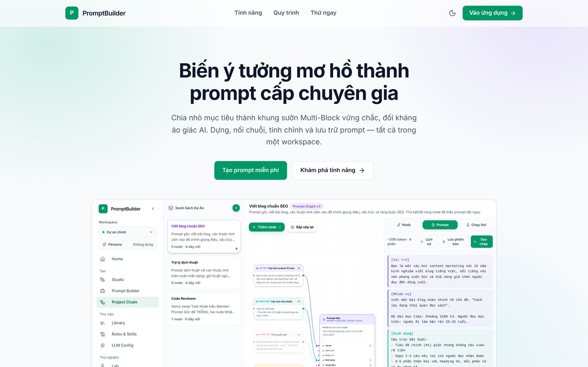
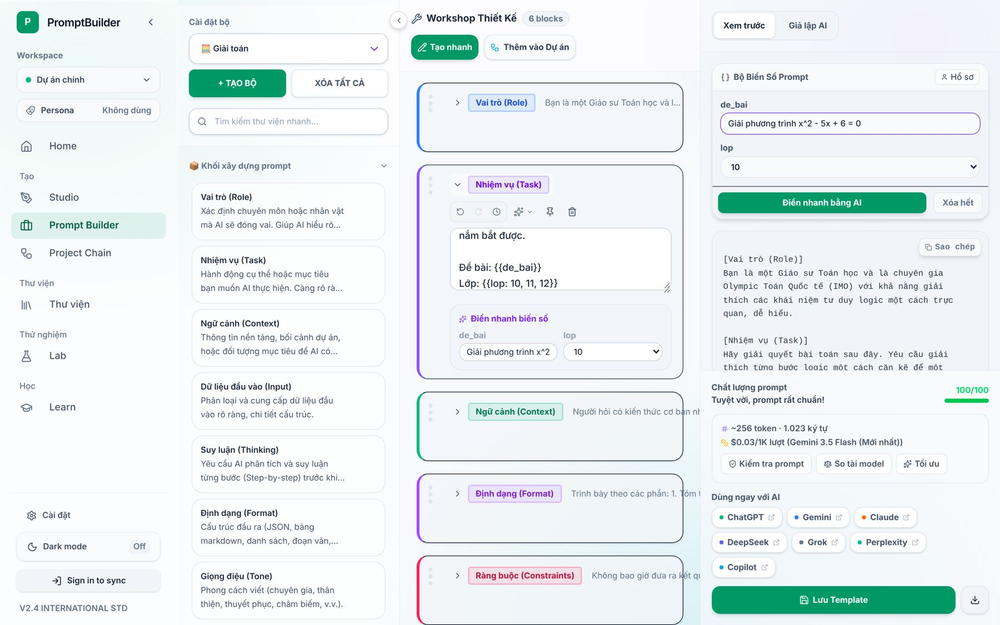
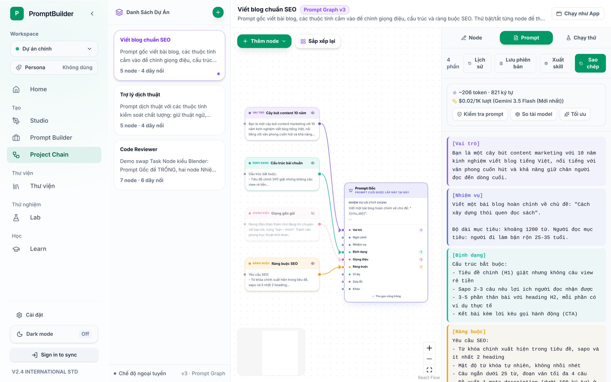
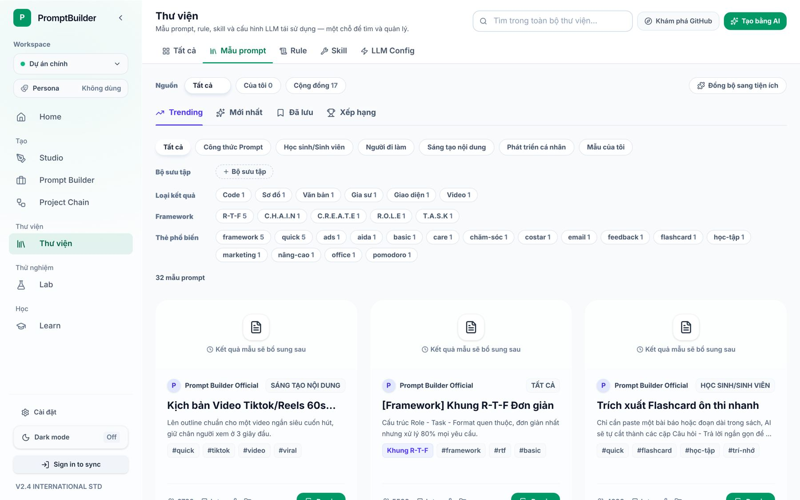
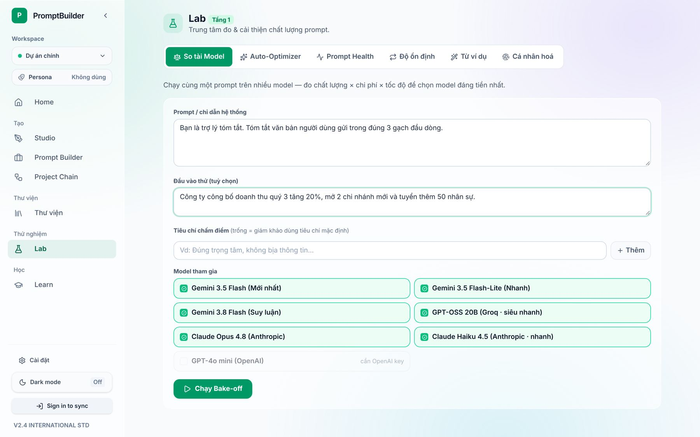
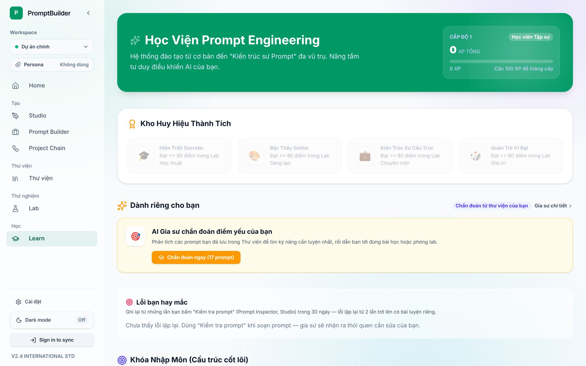

# Báo cáo tổng quan sản phẩm PromptBuilder

Ngày lập: 20/11/2026 · Phiên bản sản phẩm: V2.4 (commit `b3ca83d`) · Nguồn: mã nguồn, tài liệu thiết kế trong `docs/superpowers/specs/` và đợt kiểm thử ngày 20/11/2026.

---

## Tóm tắt điều hành

PromptBuilder là một **môi trường làm việc trọn gói cho prompt** (prompt workspace), chạy trên trình duyệt. Sản phẩm giúp người dùng đi hết vòng đời của một prompt: nảy ý tưởng → soạn có cấu trúc → lắp ráp thành quy trình → kiểm thử và đo lường → tối ưu → lưu trữ, chia sẻ → đưa vào sử dụng thật qua app, API hoặc agent.

Điểm khác biệt chính là sản phẩm **đối xử với prompt như phần mềm**: prompt có cấu trúc khối, biến số, phiên bản, bộ test, điểm chất lượng, lịch sử hồi quy. Các kỹ thuật vốn chỉ kỹ sư AI dùng (so sánh model, đo độ ổn định, tối ưu tự động) được đưa vào giao diện bấm-chạy, bằng tiếng Việt.

Về kỹ thuật, sản phẩm đã có quy mô đáng kể: khoảng **36.000 dòng mã** frontend trong 180 file, 6 hàm serverless, **503 unit test** đều đạt, 14 tài liệu thiết kế. Sản phẩm hỗ trợ 7 model AI từ 4 nhà cung cấp (Google, Anthropic, OpenAI, Groq).

Rủi ro lớn nhất hiện nay không nằm ở công nghệ mà ở **trải nghiệm người mới**: khách chưa đăng nhập gần như không dùng được tính năng AI nào, kể cả tính năng quảng cáo là "không cần đăng nhập". Sửa điều này là ưu tiên số một trước khi mở rộng người dùng.

---

## 1. Giới thiệu sản phẩm

### 1.1. Sản phẩm là gì

PromptBuilder là ứng dụng web giúp **viết, quản lý, kiểm thử và triển khai prompt** cho các mô hình ngôn ngữ lớn (LLM) như Gemini, Claude, GPT.

Khẩu hiệu sản phẩm: *"Biến ý tưởng mơ hồ thành prompt cấp chuyên gia"* — chia mục tiêu thành khung nhiều khối (Multi-Block), chống "ảo giác" AI, dựng – nối chuỗi – tinh chỉnh – lưu trữ prompt trong một workspace.

### 1.2. Vấn đề sản phẩm giải quyết

Người dùng AI phổ thông gặp bốn vấn đề lặp lại:

1. **Prompt viết vội, thiếu cấu trúc** → câu trả lời chung chung, sai định dạng, bịa thông tin.
2. **Prompt tốt bị thất lạc** → nằm rải rác trong lịch sử chat, ghi chú, không tái sử dụng được.
3. **Không biết prompt có thật sự tốt không** → không có cách đo, không biết model nào hợp, không biết sửa xong có tốt hơn không.
4. **Khó đưa prompt vào công việc thật** → từ một prompt hay đến một công cụ cho đồng nghiệp hoặc hệ thống khác dùng là một khoảng cách lớn.

PromptBuilder giải quyết lần lượt bằng: trình soạn theo khối, thư viện, phòng thí nghiệm đo lường (Lab), và xuất bản thành App / API / MCP / skill cho agent.

### 1.3. Tầm nhìn

Trở thành **"IDE cho prompt"** của người dùng nói tiếng Việt: nơi người mới học được cách viết prompt, người đi làm có thư viện prompt đáng tin cậy, và người làm sản phẩm AI có công cụ kiểm thử, phiên bản hoá và triển khai prompt như mã nguồn.

---

## 2. Đối tượng người dùng và tình huống sử dụng

| Nhóm người dùng | Nhu cầu chính | Tính năng phục vụ |
|---|---|---|
| Học sinh, sinh viên | Học cách dùng AI đúng cách, ôn thi, làm bài | Học viện (Learn), gia sư Socratic, mẫu "Học sinh/Sinh viên" |
| Giáo viên | Soạn prompt dạy học, gia sư không giải hộ, chấm bài | Rule "Mentor AI", skill "Chấm bài theo Rubric", bộ "Giải toán" |
| Người đi làm văn phòng | Email, báo cáo, tóm tắt nhanh, đúng giọng | Thư viện mẫu, Studio "Tăng cường nhanh", tiện ích trình duyệt |
| Người sáng tạo nội dung, marketer | Kịch bản video, bài SEO, quảng cáo | Mẫu TikTok/SEO, Prompt Graph "Viết blog chuẩn SEO" |
| Lập trình viên | Rule cho Cursor/Claude Code, review code, prompt cho sản phẩm | Rule/Skill, xuất CLAUDE.md/.cursorrules, API/MCP, Lab |
| Nhóm làm sản phẩm AI | Kiểm thử, chọn model, theo dõi chất lượng | Bake-off, Prompt Health, Profiler, Auto-Optimizer |

**Ví dụ một ngày làm việc:** một giáo viên mở mẫu "Giải toán" trong Builder → điền biến đề bài và lớp → so tài trên 3 model để chọn model rẻ mà vẫn đúng → lưu thành template → đóng gói thành App chia sẻ cho học sinh → học sinh bấm 👍/👎 → phản hồi xấu biến thành test trong Prompt Health → Optimizer đề xuất bản tốt hơn.

---

## 3. Bản đồ tính năng

Sản phẩm tổ chức theo **bốn nhóm việc**, khớp với vòng đời của một prompt.

| Nhóm | Tab | Vai trò trong vòng đời |
|---|---|---|
| **Tạo** | Studio · Prompt Builder · Project Chain (Prompt Graph) | Từ ý tưởng đến prompt hoàn chỉnh |
| **Thư viện** | Thư viện (Mẫu prompt · Rule · Skill · LLM Config) | Lưu trữ, tìm, chia sẻ, tái sử dụng |
| **Thử nghiệm** | Lab (6 chế độ) | Đo lường, so sánh, tối ưu |
| **Học** | Learn (Học viện, gia sư, bản tin) | Nâng kỹ năng người dùng |

### 3.1. Nhóm Tạo

**Prompt Studio** là dây chuyền 6 bước dẫn người dùng từ ý tưởng thô đến prompt hoàn chỉnh (nháp, tăng cường, kiểm tra, nâng cấp, hoàn tất), cùng chế độ "Tăng cường nhanh" một bước.

**Prompt Builder** là trình soạn theo khối với 17 loại khối (Vai trò, Nhiệm vụ, Ngữ cảnh, Định dạng, Ràng buộc, Suy luận, Ví dụ, Tự xem xét…), 6 bộ dựng sẵn, 5 framework (R.O.L.E, C.R.E.A.T.E, P.E.R.S.O.N.A, T.A.S.K, RACE). Biến số `{{ten_bien}}` và biến chọn `{{lop: 10, 11, 12}}` tự sinh ô nhập. Có điểm chất lượng, đếm token, ước tính chi phí, linter AI, lịch sử phiên bản, và nút mở thẳng sang 7 trợ lý AI phổ biến.

**Project Chain v3 — "Prompt Graph"** là trình lắp prompt bằng đồ thị node: một node Prompt Gốc có các cổng đặt tên, các node thuộc tính cắm dây vào, bật/tắt từng node và thấy prompt cuối thay đổi tức thì. Có 6 dạng node: văn bản, modifier (sáng tạo, giọng điệu, chống bịa đặt, độ dài…), few-shot, dữ liệu từ URL, bundle (nhóm), và **AI biến đổi** (AI viết lại/rút gọn/dịch, kết quả được lưu đệm). Đồ thị có thể "Chạy như App", xuất bản thành **HTTP API** hoặc **MCP server** cho agent gọi.

### 3.2. Nhóm Thư viện

Một tab gộp bốn loại tài sản:

- **Mẫu prompt** — kho chính thức và cộng đồng, lọc theo danh mục/framework/tag, xem chi tiết, thích, lưu, bình luận, Remix sang Builder hoặc Graph, **bảng xếp hạng** theo Nổi bật / Được thích / Được dùng / Điểm chất lượng.
- **Rule** — quy tắc ứng xử cho AI (gia sư Socratic, review code, SEO, DevOps, SQL, pháp lý, tài chính…), có lọc theo ngành và disclaimer cho lĩnh vực chuyên môn cao.
- **Skill** — kỹ năng có khai báo biến đầu vào và chạy thử.
- **LLM Config** — bộ Custom Instructions 4 phần cho Gemini/ChatGPT/Claude kèm hướng dẫn cài đặt.

Công cụ đi kèm: tìm kiếm chung cho mọi loại, **Khám phá GitHub** (nhập skill/rule từ các repo nổi tiếng hoặc tìm trực tiếp), **Tạo bằng AI** từ một câu mô tả, xuất đa định dạng (SKILL.md, .cursorrules, AGENTS.md, CLAUDE.md), đồng bộ sang tiện ích trình duyệt.

### 3.3. Nhóm Thử nghiệm — Lab

| Chế độ | Câu hỏi trả lời |
|---|---|
| **So tài Model (Bake-off)** | Model nào cho kết quả tốt nhất với chi phí và tốc độ hợp lý? |
| **Auto-Optimizer** | Có phiên bản prompt nào tốt hơn bản hiện tại không? (tiến hoá nhiều vòng, chạy trên server) |
| **Prompt Health** | Prompt có còn đạt bộ test sau khi sửa hoặc đổi model không? (CI cho prompt, chạy tự động hằng ngày) |
| **Độ ổn định (Profiler)** | Chạy N lần có ra kết quả nhất quán, đúng định dạng không? → Ổn định / Dao động / Giòn |
| **Từ ví dụ (Induction)** | Có sẵn vài cặp đầu vào → đầu ra, prompt nào tạo ra được chúng? |
| **Cá nhân hoá** | Hệ thống đã học được gì về phong cách viết của tôi? |

Ba chế độ trên nối với nhau thành **"Prompt Flywheel"**: phản hồi 👍/👎 từ người dùng App → biến thành test → Prompt Health phát hiện test trượt → Optimizer đề xuất bản tốt hơn → lưu thành phiên bản mới, có điểm kèm theo.

### 3.4. Nhóm Học — Learn

- **Học viện** có trò chơi hoá: XP, cấp độ, huy hiệu.
- **Khoá nhập môn 3 bậc**: giải phẫu prompt bằng thẻ XML → trò chơi đoán thẻ → kéo thả dựng AI Mentor.
- **4 phòng lab nội dung** (Học thuật, Sáng tạo, Công việc, Giải trí) và **2 chế độ thử thách** (Thám tử Prompt, Đối đầu).
- **Gia sư cá nhân hoá**: chẩn đoán điểm yếu từ thư viện của người dùng; mục **"Lỗi bạn hay mắc"** ghi lại lỗi từ linter, nhóm lỗi lặp ≥ 2 lần trong 30 ngày có bài luyện riêng.
- **Bản tin AI**: tin tức xu hướng AI, tóm tắt kèm mức ảnh hưởng.

### 3.5. Tiện ích xuyên suốt

- **Command Palette** (`Ctrl+K`) tìm nhanh mọi thứ.
- **Workspace** nhiều dự án; **Persona** chèn làm chỉ dẫn hệ thống cho mọi lần chạy AI.
- **Dark mode**, giao diện **mobile** với thanh tab đáy.
- **Cài đặt**: gợi ý gõ nhanh (Tab để điền), sao lưu/khôi phục JSON, thống kê lượt gọi AI.
- **Tiện ích trình duyệt** (Chrome MV3): tìm prompt, điền biến, chèn thẳng vào ô chat của ChatGPT / Claude / Gemini.

---

## 4. Kiến trúc kỹ thuật

### 4.1. Sơ đồ tổng thể

Hệ thống gồm bốn lớp, dữ liệu đi theo các luồng sau:

| Lớp | Thành phần | Kết nối tới |
|---|---|---|
| Trình duyệt | React 19 + Vite: các tab Home, Studio, Builder, Prompt Graph, Thư viện, Lab, Learn; `WorkspaceContext` giữ user, key, workspace | Gửi Firebase ID token tới API serverless; đọc/ghi Firestore theo thời gian thực |
| Serverless (Vercel) | `ai.ts`, `optimize.ts`, `run.ts`, `health-cron.ts`, `fetch-url.ts`, `github.ts` | Gọi Gemini / Groq / Anthropic; nhận lời gọi HTTP API và MCP từ hệ thống ngoài, agent |
| Dữ liệu | Firebase Auth (Google) + Firestore | Phục vụ cả trình duyệt và serverless |
| Tiện ích trình duyệt | Chrome MV3 (`extension/`) | Nhận thư viện từ app qua `postMessage`; chèn prompt vào ChatGPT / Claude / Gemini |

### 4.2. Thành phần chính

**Frontend:** React 19, Vite 6, TypeScript 5.8, Tailwind v4, `motion` cho hiệu ứng, `@xyflow/react` cho đồ thị node, `lucide-react` cho biểu tượng. Điều hướng không dùng thư viện router: tab đồng bộ với `window.location.hash`, các tab nặng được tải lười (lazy) và giữ nguyên trạng thái sau khi mở.

**Backend:** 6 hàm serverless trên Vercel, mỗi hàm tự chứa (không import file cục bộ):

| Hàm | Vai trò |
|---|---|
| `ai.ts` | Proxy gọi model, giấu API key của hệ thống |
| `optimize.ts` | Vòng tối ưu prompt tiến hoá |
| `run.ts` | Chạy App đã xuất bản qua HTTP API và **MCP server** (`/api/mcp`) |
| `health-cron.ts` | Chạy Prompt Health tự động mỗi ngày (21:00 UTC) |
| `fetch-url.ts` | Cào nội dung trang web cho node Web |
| `github.ts` | Tìm repo, duyệt cây file, tải nội dung từ GitHub |

**Dữ liệu:** Firebase Auth (đăng nhập Google) và Firestore với 12 collection: templates, projects, rules, skills, workspaces, personas, bookmarks, healthSuites, sharedApps, suggestionModels, appFeedback, apiKeys. Khách chưa đăng nhập dùng localStorage; khi đăng nhập, dữ liệu khách tự đẩy lên đám mây.

**AI đa nhà cung cấp:** tên model khai báo tập trung ở `src/config/models.ts`. Hiện có 7 model: Gemini 3.5 Flash, Gemini 3.5 Flash-Lite, Gemini 3.8 Flash, GPT-OSS 20B (Groq), Claude Opus 4.8, Claude Haiku 4.5, GPT-4o mini. Đa số hàm AI có cơ chế dự phòng Gemini → Groq.

### 4.3. Nguyên tắc thiết kế mã

- **Tách logic thuần** ra `src/utils/` (42 file) và `src/services/` (23 file) để kiểm thử đơn vị: biên dịch đồ thị, chấm điểm độ ổn định, suy ngược prompt, xếp hạng, nhật ký lỗi… đều là hàm thuần.
- **Quy ước giao diện thống nhất**: thông báo qua `toast()`, xác nhận qua `confirmDialog()`, màu theo token ngữ nghĩa tự đổi sáng/tối, ba cấp kính `glass-1/2/3`.
- **Một nguồn dữ liệu** cho Rule/Skill (`collectionStore`), cho người dùng và key (`WorkspaceContext`).

---

## 5. Bảo mật và dữ liệu

- **Key AI của hệ thống không bao giờ xuống trình duyệt**: mọi lời gọi bằng key mặc định đi qua proxy `api/ai.ts`, xác thực bằng Firebase ID token.
- **Key riêng của người dùng** (nếu nhập) chỉ lưu trong localStorage của trình duyệt đó; file sao lưu JSON **không** chứa API key.
- **Firestore rules mặc định chỉ chủ sở hữu** được đọc/ghi. Ngoại lệ có kiểm soát: template và Shared App có phần công khai; phản hồi App do người dùng App tạo nhưng chỉ chủ App đọc; điểm chất lượng chỉ chủ template ghi.
- **API key cho HTTP API/MCP** được lưu dưới dạng băm SHA-256 (`apiKeys/{sha256}`); chủ tạo/thu hồi, trường `usage` chỉ server ghi.
- **Tiện ích trình duyệt** hỏi xác nhận lần đầu mỗi trang trước khi đồng bộ, chỉ nhận tin nhắn từ nguồn được phép.
- **AI có trách nhiệm**: preset pháp lý/tài chính có câu miễn trừ; có khối và node chống bịa đặt.

---

## 6. Chất lượng và quy trình phát triển

| Chỉ số | Giá trị |
|---|---|
| Dòng mã frontend (không tính test) | ~36.400 dòng / 180 file |
| Component giao diện | 97 |
| Dòng mã backend | ~2.000 dòng / 6 hàm |
| Unit test | **503 test / 63 file — 100% đạt** |
| Kiểm tra kiểu TypeScript (frontend + api) | 0 lỗi |
| Tài liệu thiết kế (spec) | 14 |
| Lịch sử | 88 commit, từ 09/07/2026 |

**CI** (GitHub Actions) chạy 4 bước trên mỗi lần đẩy và mỗi pull request: lint (tsc), test (vitest), build (vite), type-check `api/`. **Vercel** tạo bản xem trước cho mỗi pull request. Mỗi tính năng lớn có spec viết trước khi làm, lưu trong `docs/superpowers/specs/`.

**Nợ kỹ thuật đã ghi nhận:** một số component quá lớn cần chia nhỏ (RulesSkillsView, ConfigsView, aiService), chưa dùng thư viện quản lý dữ liệu máy chủ (TanStack Query), chưa có đa ngôn ngữ (i18n) và chuẩn truy cập (a11y) toàn site. Gói tải về khá nặng (vendor ~826 kB, syntax-highlighter ~617 kB, firebase ~569 kB trước nén).

---

## 7. Định vị và điểm khác biệt

Thị trường công cụ prompt hiện chia thành ba nhóm: **kho prompt** (chia sẻ mẫu), **công cụ cho kỹ sư** (đánh giá, theo dõi prompt bằng code), và **trình dựng agent/quy trình**. Ít sản phẩm nối liền cả ba cho người dùng phổ thông.

PromptBuilder nổi bật ở năm điểm:

1. **Trọn vòng đời trong một nơi**: tạo → lưu → đo → tối ưu → triển khai → nhận phản hồi → cải thiện.
2. **Prompt Graph**: lắp prompt bằng node kiểu Blender, bật/tắt để so sánh, swap nhiệm vụ mà không sửa chữ — cách tiếp cận trực quan hiếm thấy.
3. **Kỹ thuật của kỹ sư AI trong giao diện phổ thông**: Bake-off, Prompt Health, Profiler, Optimizer, Induction.
4. **Cầu nối sang hệ sinh thái agent**: xuất SKILL.md / CLAUDE.md / AGENTS.md / .cursorrules, nhập từ GitHub, xuất bản MCP server.
5. **Tiếng Việt và giáo dục**: học viện trò chơi hoá, gia sư Socratic "không giải hộ", gia sư theo lỗi cá nhân.

---

## 8. Phân tích SWOT

| | Tích cực | Tiêu cực |
|---|---|---|
| **Nội tại** | **Điểm mạnh:** phạm vi tính năng rộng và sâu; Prompt Graph độc đáo; nền mã sạch, nhiều test; đa model; tiếng Việt; thiết kế giao diện đẹp, nhất quán | **Điểm yếu:** người mới chưa đăng nhập gần như không dùng được AI; nhiều tính năng → đường học dốc; một số lỗi giao diện và ngôn ngữ chưa thống nhất; gói tải nặng; chưa có i18n/a11y |
| **Bên ngoài** | **Cơ hội:** AI vào trường học và doanh nghiệp Việt Nam; xu hướng agent và MCP; nhu cầu chọn model rẻ khi giá thay đổi liên tục; chợ prompt có kiểm chứng | **Thách thức:** các trợ lý AI lớn tự tích hợp tính năng tối ưu prompt; model mới thay đổi nhanh làm preset lỗi thời; chi phí gọi AI nếu mở miễn phí; phụ thuộc Firebase/Vercel |

---

## 9. Hiện trạng sản phẩm

Đợt kiểm thử ngày 20/11/2026 (chi tiết trong `docs/reports/2026-11-20-kiem-thu/BAO-CAO.md`) cho thấy:

- **Các tính năng không cần AI hoạt động đúng**: Builder, biến số, Prompt Graph (bật/tắt node, thêm node, form App), Thư viện (lọc, chi tiết, Remix, xếp hạng, tìm kiếm), cấu hình Lab, bài học và trò chơi, Command Palette, persona, dark mode, mobile.
- **Phần AI chưa kiểm được chất lượng** vì cần đăng nhập Google.
- **16 vấn đề** được ghi nhận, trong đó 2 vấn đề mức cao:
  1. "Tăng cường nhanh — không cần đăng nhập" thực tế không chạy được với khách.
  2. Thông báo lỗi chỉ người dùng tới "Cài đặt" để nhập API key, nhưng Cài đặt không có ô này.
- Các vấn đề khác: khung Few-shot vỡ bố cục và không dấu, sidebar đè lên modal, đếm sai "prompt của bạn" ở Gia sư, bản tin AI hiện tin cũ mà vẫn ghi "thời gian thực", vài thông báo tiếng Anh, ảnh trang chủ là giao diện cũ.

**Đánh giá mức độ sẵn sàng:** sản phẩm đã sẵn sàng cho **người dùng đã đăng nhập** và nhóm thử nghiệm nội bộ. Để mở rộng ra công chúng, cần xử lý trải nghiệm người mới và nhóm lỗi giao diện/ngôn ngữ.

---

## 10. Lộ trình đề xuất

### Giai đoạn 1 — Hoàn thiện trải nghiệm người mới (0–1 tháng)

1. Cho khách dùng thử AI thật: hạn mức miễn phí nhỏ, hoặc cho "Tăng cường nhanh" dùng key riêng.
2. Đưa ô API key vào Cài đặt; thống nhất thông báo lỗi ("cần đăng nhập" khác "key sai/hết hạn mức").
3. Sửa 16 vấn đề trong báo cáo kiểm thử, ưu tiên mức cao và trung bình.
4. Thêm hướng dẫn nhập môn (onboarding) 3 bước cho người lần đầu vào app.

### Giai đoạn 2 — Mở rộng và cộng tác (1–6 tháng)

- Workspace nhóm: chia sẻ, phân quyền, bình luận, duyệt thay đổi prompt như pull request.
- Cảnh báo Prompt Health qua email/Slack khi điểm tụt hoặc model thay đổi.
- Bảng chi phí thực tế theo dự án và model, gợi ý model rẻ hơn.
- i18n (tiếng Anh) và a11y; chia nhỏ component lớn; giảm dung lượng gói tải.

### Giai đoạn 3 — Đột phá (6–18 tháng)

- **Prompt Graph thành trình dựng agent không cần code**: node gọi công cụ, rẽ nhánh, vòng lặp; xuất MCP/skill bằng một nút.
- **Chợ prompt có kiểm chứng**: chấm điểm độc lập bằng bộ test chuẩn, chứng nhận chất lượng, cho tác giả kiếm tiền.
- **Flywheel tự động hoàn toàn**: phản hồi thật → test → tối ưu chạy nền → đề xuất phiên bản kèm bằng chứng.
- **Chế độ lớp học**: giáo viên giao bài, theo dõi tiến độ, bám chương trình phổ thông.
- **Đa phương thức** (ảnh, video, giọng nói) và **red-team tự động** chống prompt injection.

### Gợi ý chỉ số theo dõi (KPI)

| Chỉ số | Ý nghĩa |
|---|---|
| Tỉ lệ khách → đăng nhập | Hiệu quả trải nghiệm người mới |
| Số prompt được lưu / người dùng / tuần | Mức độ dùng thư viện |
| Số suite Prompt Health đang hoạt động | Mức độ dùng tính năng "kỹ sư" |
| Số App / API / MCP được xuất bản và lượt gọi | Giá trị triển khai thật |
| Tỉ lệ 👍 trên App | Chất lượng prompt ngoài thực tế |
| Bài học hoàn thành, XP trung bình | Hiệu quả giáo dục |

---

## 11. Kết luận

PromptBuilder là một sản phẩm **tham vọng và có chiều sâu**, đã vượt xa mức "kho prompt" để trở thành môi trường làm việc đầy đủ cho prompt: soạn có cấu trúc, lắp ráp trực quan, đo lường khoa học, tối ưu tự động và triển khai sang hệ sinh thái agent. Nền tảng kỹ thuật vững (mã có tổ chức, 503 test, CI đầy đủ, bảo mật key đúng cách) là lợi thế để phát triển nhanh và an toàn.

Việc cần làm ngay là **hạ rào cản cho người mới**, để giá trị của sản phẩm được nhìn thấy trong vài phút đầu. Sau đó, hai hướng có tiềm năng tạo khác biệt lớn nhất là **Prompt Graph thành trình dựng agent** và **giáo dục AI bằng tiếng Việt** cho trường học.

---

## Phụ lục — Tài liệu liên quan

- Báo cáo kiểm thử chi tiết: `docs/reports/2026-11-20-kiem-thu/BAO-CAO.md` (kèm 44 ảnh và danh sách 16 vấn đề).
- Hướng dẫn triển khai: `DEPLOY.md`.
- Tài liệu thiết kế tính năng: `docs/superpowers/specs/` (14 spec).
- Kiến trúc và quy ước cho người phát triển: `CLAUDE.md`.
